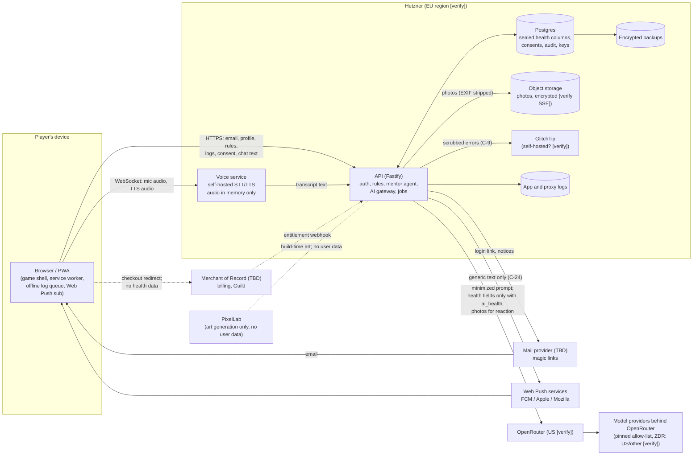

# Kitchen Quest: Personal Data Inventory

**Item:** C-33 (risk assessment and DPIA), first deliverable. Feeds the GDPR Art. 30 record of processing, the DPIA (`dpia.md`) and the risk register (`risk-register.md`).
**Date:** 2026-11-09. **Status:** started at M2; the owner of each later milestone adds that milestone's rows in the same PR as its schema.
**Sources:** `apps/api/src/db/schema.ts` and migrations `0000`–`0002` (built); uncommitted Step 2c work (consent, keys, audit, retention: in progress, listed as "planned M2"); spec §4, §5, §7, §9, §16–§20; `plans/m1-core`, `plans/m2-api`; compliance report §2–§6 (C-ids).
**Caveat:** only M1 and M2 have plan files. Rows for M3 onwards come from the spec and the C-id table, so column names are proposed, not final. This is not legal advice; **[verify]** marks facts to confirm and **[lawyer]** marks questions for counsel.

## 1. How to read this

**Category:** `identifier`, `health`, `location`, `child`, `usage`, `technical`. Health includes anything that reveals or infers a condition, a disability or a religious diet (GDPR Art. 9 covers both health and religion).

**Basis / consent purpose.** The C-1 purposes are `health_data`, `ai_health`, `voice`, `pantry_location`, `research`. Where no purpose applies, the working basis is shown: **contract** (GDPR Art. 6(1)(b), service the player asked for), **legit.** (Art. 6(1)(f), security and abuse prevention), **legal** (tax, breach duties). For US state health laws the "necessary to provide the requested service" exception may cover some collection **[lawyer: how far]**, so the plan is to take `health_data` consent for all of it.

**Sealed.** `S-U` = AES-256-GCM at the application layer under the per-user data key, with AAD = header + table + user id + row id (C-2/C-3/C-4). `S-1` = today's single `DATA_KEY` sealing (`apps/api/src/crypto/seal.ts`). `hash` = only a hash is stored. `no` = plaintext in a column or file.

**Export / delete.** "E" = in `GET /me/export` (C-7). "D" = removed by `DELETE /me` (C-8), counting crypto-shredding for backups (C-4). Where either is not yet covered it says so.

**Status:** `built`, `planned M-n` (a milestone plan or spec section commits to it), `proposed` (this inventory proposes it; not in any plan yet).

## 2. Data-flow diagram

Trust boundaries: device to API, API to every third party. Everything left of OpenRouter, mail, push, the Merchant of Record and PixelLab is under our control. The edges into those four are where C-13/C-14, C-24 and C-34 apply.

## 3. Inventory

### 3.1 Account and authentication

| ID | Element | Where | Category | Basis / purpose | Sealed | Retention | Processors | E / D | Status |
|---|---|---|---|---|---|---|---|---|---|
| A-1 | Email address | `users.email` (citext, unique) | identifier | contract | no (needed for lookup) | life of account | Hetzner; mail provider | E, D | built |
| A-2 | Email address of sign-in attempts, including people who never become users | `login_tokens.email` (no FK to `users`) | identifier | contract / legit. | no | 24 h after expiry or use (C-6) | Hetzner | not in E; **D only via C-8 (delete by email)** | built; retention planned M2 |
| A-3 | Login token | `login_tokens.token_hash` | technical | legit. (security) | hash | as A-2 | Hetzner | no / D via A-2 | built |
| A-4 | Age confirmation timestamp ("I'm 16+") | `users.age_confirmed_at` | identifier (age attestation) | contract; COPPA/age gate **[lawyer]** | no | life of account | Hetzner | E, D | built; C-39 may change the screen but keeps only this column |
| A-5 | Account creation time | `users.created_at` | usage | contract | no | life of account | Hetzner | E, D | built |
| A-6 | Session token | `sessions.token_hash`, `user_id`, `expires_at`, `created_at` | technical | contract / legit. | hash | delete at expiry (30 d) (C-6) | Hetzner | D | built; retention planned M2 |
| A-7 | Session cookie | browser cookie (`HttpOnly; Secure; SameSite=Lax`) | technical | contract | n/a | 30 d | none | n/a | built |
| A-8 | IP address and user agent at sign-in and on requests | reverse-proxy/access logs; rate-limit counters (store **[verify]**); possibly `audit_events` | identifier (IP) / technical | legit. (abuse, security) | no | **unset, proposed 30 d** | Hetzner | not in E; D only if keyed (**gap**) | built (implicit); policy proposed |
| A-9 | Session list / device label for "sign out everywhere" | `sessions` (extend) | technical | legit. | no | with A-6 | Hetzner | E, D | planned M2 (C-10b, optional) |
| A-10 | Email as held by the mail provider (recipient, delivery logs, suppression list) | mail provider (TBD) | identifier | contract | provider-side | provider default **[verify]**; target <= 30 d | mail provider | D: processor-deletion queue (C-8) | planned M2/M12 (provider not chosen) |
| A-11 | Magic-link token inside the email body | mail provider copy of the message | technical (credential) | contract | hash at rest in our DB only | provider-side **[verify]** | mail provider | n/a | built (`SmtpMailer`) |

### 3.2 Profile and settings

| ID | Element | Where | Category | Basis / purpose | Sealed | Retention | Processors | E / D | Status |
|---|---|---|---|---|---|---|---|---|---|
| P-1 | Country, region | `profiles.country`, `profiles.region` | location (coarse) | contract; used for seasonality and region gating (C-44) | no | life of account | Hetzner | E, D | built |
| P-2 | Market days, meals per week | `profiles.market_days`, `profiles.meals_per_week` | usage | contract | no | life of account | Hetzner | E, D | built |
| P-3 | Meal windows (name, start, end) | `profiles.meal_windows` (jsonb) | usage; with free-text names could imply a condition or fast (e.g. "Ramadan suhoor") | contract; **[lawyer]** whether `health_data` | no | life of account | Hetzner | E, D | built. Decision needed: treat window names as sensitive free text (see risk R-17) |
| P-4 | Reminder times, push preferences | `profiles` or `reminders` | usage | contract | no | life of account | Hetzner | E, D | planned M9 |
| P-5 | Voice accessibility flag (`accessibility_voice`) | `profiles` column or sealed row | health (implies disability) | `health_data` (C-19) | **S-U required** | life of account | Hetzner | E, D | planned M2 (if added in Step 4) / M7; **not in the current schema** |
| P-6 | Calorie display toggle and other UI settings | `profiles` (extend) | usage | contract | no | life of account | Hetzner | E, D | proposed. Hidden calorie toggle could imply a disordered-eating history; keep it out of AI prompts and analytics |
| P-7 | Notice acknowledgements (policy version seen) | `consents` | usage | legal | no | with consent rows | Hetzner | E, D (pseudonymized if kept, see J-1) | planned M2 |

### 3.3 Health data (the core)

| ID | Element | Where | Category | Basis / purpose | Sealed | Retention | Processors | E / D | Status |
|---|---|---|---|---|---|---|---|---|---|
| H-1 | Allergy and diet rules: target ids, type, severity, limit, phase, journey id | `rules.sealed` (blob; row id = rule id) | health (allergies, intolerances); religious diets are Art. 9 religion | `health_data` | **S-1 today**; S-U with AAD when Step 2c lands (C-3/C-4) | until user deletes the rule or account | Hetzner (ciphertext only) | E (decrypted), D | built |
| H-2 | Rule free-text `note` ("the user's own words") | inside `rules.sealed` | health or any special category (religion, disability, third-party facts) | `health_data` | as H-1 | as H-1 | as H-1 | E, D | built. Free text is unbounded: see R-17 |
| H-3 | Rule metadata: owner, created and updated time | `rules.user_id`, `created_at`, `updated_at` | usage (reveals that the user has at least one rule and when it changed) | `health_data` | no | as H-1 | Hetzner | E, D | built. Row count is itself weakly sensitive |
| H-4 | Ingredient and category targets resolved by AI during rule expansion | AI request (only the typed term); result saved in H-1 | health | `ai_health` | n/a in transit; then H-1 | not retained by us; provider ZDR | OpenRouter, model provider | covered via H-1 | planned M8 (C-22) |
| H-5 | Diet journeys and enrollments (e.g. low-FODMAP, custom journeys: name, phases, rule sets) | `journeys`, `journey_enrollments` | health (journey implies condition) | `health_data` | S-U (C-23) | until deleted | Hetzner | E, D | planned M9 |
| H-6 | Symptom check-ins: symptom names, 0 to 3 scores, free-text note, date | `symptom_checkins` | health | `health_data` | S-U (C-23); date may stay plain | until deleted | Hetzner | E, D | planned M9 |
| H-7 | Meal logs: dish or free-form text, servings eaten, estimates, slot, time | `meal_logs` | health (nutrition; infers conditions) | `health_data` | S-U (C-23); date and slot may stay plain | until deleted | Hetzner | E, D | planned M9 |
| H-8 | Nutrition snapshots and weekly aggregates | `nutrition_snapshots` or computed | health (derived) | `health_data` | S-U if stored (derived data is still health data) | rebuild on demand preferred; else as H-7 | Hetzner | E, D | planned M5/M9 |
| H-9 | Low-intake check-in | **computed on the fly, never stored as a label** (C-27) | health inference | `health_data` | n/a | none | none | n/a | planned M9; control is the absence of data |
| H-10 | Body metrics (weight etc.) | not designed | health | `health_data` + separate opt-in | S-U | n/a | n/a | n/a | out of v1 (spec §5); listed so nobody adds it without a DPIA update |
| H-11 | Pantry items, market list, meal plan, plan items | `pantry_items`, `meal_plans`, `plan_items`, `market_runs` | usage; pantry contents can imply diet or condition (gluten-free staples) | contract; **[lawyer]** whether `health_data` | proposed S-U for pantry and plan | until deleted | Hetzner | E, D | planned M5/M9 |
| H-12 | Margin Notes (own recipe variations) and private recipes (Cooklang) | `recipe_notes`, `private_recipes` | usage; free text can contain health facts | contract; `health_data` if free text can hold health content | proposed S-U | until deleted | Hetzner | E (also `.cook` files), D | planned M5 |
| H-13 | "Cooked for Someone" record (who the player fed) | `shared_table` | usage; **data about third parties** | contract | proposed S-U | until deleted | Hetzner | E, D | planned M5. Proposed rule: store a label the player types, never a contact, and never a health fact about the other person (see R-19) |
| H-14 | Household Kitchen membership and sharing opt-ins | `households`, `household_members` | usage; sharing flags can reveal a member's rules | `health_data` per member (C-25) | per-member S-U | until member leaves or deletes | Hetzner | E (own data only), D | planned M9 |
| H-15 | Clinician share artefact (expiring link or PDF) | `shares` (token hash, expiry, scope) and the generated report | health | `health_data` and the player's own action | token as hash; report content generated on demand, not stored if possible | 7 d default, revocable (C-26) | Hetzner | E (share log), D | planned M9 or later |

### 3.4 AI requests and conversations

| ID | Element | Where | Category | Basis / purpose | Sealed | Retention | Processors | E / D | Status |
|---|---|---|---|---|---|---|---|---|---|
| I-1 | Mentor and NPC conversation transcripts (text and voice transcripts) | `conversations`, `messages` | health (free text reveals allergies, symptoms, meals); possibly religion and third parties | `health_data`; `ai_health` for the AI leg | S-U (C-12) | **30 days default**, user-clearable ("forget this conversation") (C-12) | Hetzner | E, D | planned M3 |
| I-2 | The AI request body: persona, style guide, compact player context, tool definitions, user turn | HTTPS to OpenRouter, then the model provider. **Not stored by us** (C-15) | health when it carries rules, severities, symptoms, journey phase or meal text; otherwise usage | `ai_health` for health fields; contract for the rest | TLS in transit; no prompt logging | provider ZDR required (C-14); we keep none | OpenRouter, model providers | n/a (not stored by us); processor list in E | planned M3 |
| I-3 | Prompt context for non-consenting users | same | usage only | contract | n/a | n/a | OpenRouter | n/a | planned M3 (C-13). Test: no rule targets in the prompt without `ai_health` |
| I-4 | AI response, tool calls and proposed writes | in memory; confirmed writes land in H-1, H-6, H-7 | health | as I-2 | as destination | as destination | OpenRouter | as destination | planned M3 |
| I-5 | Recipe ingestion input: pasted text, caption, screenshot, URL | AI request; fetched page | usage (may carry personal notes) | contract | n/a; not stored beyond the draft | draft until confirmed or discarded | OpenRouter; fetched site (receives our server IP only, C-21) | E (resulting recipe), D | planned M8 |
| I-6 | NPC Q&A turns | as I-1 | health when grounded with rules | `ai_health` | S-U | as I-1 | OpenRouter | E, D | planned M8 |
| I-7 | Failed-request queue (retry queue for AI calls) | `ai_queue` or job table | health (contains the pending prompt) | as I-2 | **must be sealed or hold no content** | until retried, max 24 h proposed | Hetzner | D | planned M3 (spec §7.5); **new: not in any C-id** (see R-14) |
| I-8 | Evaluation sets | repo `evals/` | none if synthetic | n/a | n/a | n/a | none | n/a | planned M8 (C-15: synthetic or contributor-consented only) |

### 3.5 Voice

| ID | Element | Where | Category | Basis / purpose | Sealed | Retention | Processors | E / D | Status |
|---|---|---|---|---|---|---|---|---|---|
| V-1 | Microphone audio stream | browser to voice service over TLS; **memory only** | identifier-adjacent (voice) and health content; biometric only if voiceprints were derived, which P-7 bans | `voice` | n/a | none (test greps FS and logs, C-18) | Hetzner (voice host; GPU host if different, DPA) | n/a | planned M7 |
| V-2 | Partial and final STT transcripts | in memory, then I-1 | as I-1 | `voice` + `health_data` | S-U once stored | as I-1; partials never logged | Hetzner | E, D | planned M7 |
| V-3 | TTS output audio | generated per turn, streamed, not stored | technical | contract | n/a | none | Hetzner | n/a | planned M7 |
| V-4 | Voice session metadata (duration, units for allowance) | `usage_events` (feature `voice`) | usage | contract | no | 13 months | Hetzner | E (totals), D | built (table); planned M7 (writes) |

### 3.6 Photos

| ID | Element | Where | Category | Basis / purpose | Sealed | Retention | Processors | E / D | Status |
|---|---|---|---|---|---|---|---|---|---|
| F-1 | Food photos (Recipe Book, cook session) | Hetzner Object Storage, random object keys; row in `photos` (owner, key, recipe ref) | health when it shows what the player ate; can show faces, kitchens, and with EXIF, location | `health_data` | S-U client-sealed or app-sealed before upload (C-20; SSE support **[verify]**) | until user deletes (Recipe Book) | Hetzner | E (files), D via processor-deletion queue | planned M8 |
| F-2 | EXIF, GPS and device metadata | stripped before storage and before any AI call (C-20) | location, technical | none (not kept) | n/a | none | none | n/a | planned M8; test required |
| F-3 | Photo sent to AI for the cook's reaction | AI request | health | `ai_health` | TLS | provider ZDR | OpenRouter, model provider | n/a | planned M8 |
| F-4 | Face check on upload (family mode) | on device only | child / biometric question | pending counsel | n/a | stores and sends nothing | none | n/a | planned M13 (C-45) **[lawyer]** |

### 3.7 Neighborhood Pantry (location and other people)

| ID | Element | Where | Category | Basis / purpose | Sealed | Retention | Processors | E / D | Status |
|---|---|---|---|---|---|---|---|---|---|
| N-1 | Post: item, portions, made-on and keeps-until, pickup window | `pantry_posts` | usage; reveals diet | `pantry_location` | no (shown to neighbours by design) | deleted after pickup window (C-6, C-28) | Hetzner | E, D | planned M11 |
| N-2 | Approximate area (1 km grid cell, snapped on device) | `pantry_posts.cell` | location | `pantry_location` | no | as N-1 | Hetzner | E, D | planned M11 (C-28) |
| N-3 | Exact pickup spot, shared after acceptance | `pantry_handoffs` | location (precise) | `pantry_location` | S-U, visible only to the two parties | deleted at end of window | Hetzner | E, D | planned M11 |
| N-4 | Allergen tags and ingredient list on a post | `pantry_posts` | health-adjacent (of the poster's dish, not of the poster) | `pantry_location` | no | as N-1 | Hetzner | E, D | planned M11 |
| N-5 | Display handle or first name for requests | `profiles` (extend) or `pantry_handles` | identifier | `pantry_location` | no | life of account | Hetzner | E, D | planned M11; **new identifier not yet in a plan** |
| N-6 | Requests, messages between neighbours | `pantry_requests` | identifier, usage | `pantry_location` | proposed S-U | deleted with the post | Hetzner | E, D | planned M11; no free-text contact details (spec §18) |
| N-7 | Reports and blocks | `pantry_reports`, `pantry_blocks` | usage; reporter identity hidden from reported user | legit. (safety) | no | 12 months (C-29) | Hetzner | E (the user's own reports), D | planned M11 |
| N-8 | Requester's own status (OK, blocked, unverified) per post | computed on the requester's device | health | n/a (on device) | n/a | none | none | n/a | planned M11 (C-28) |
| N-9 | Static map of community fridges and food banks | public data in repo | none | n/a | n/a | n/a | none | n/a | planned M11. Viewing is not logged per user |

### 3.8 Children (Family Mode, M13)

No child data is collected until counsel signs off (P-9). The rows are reserved so the M5 schema and consent ledger are built for them.

| ID | Element | Where | Category | Basis / purpose | Sealed | Retention | Processors | E / D | Status |
|---|---|---|---|---|---|---|---|---|---|
| K-1 | Child profile: nickname, age band, preset avatar | `child_profiles` | child, identifier | parental explicit consent per child, via `consents(subject_kind='child_profile')` (C-45) | S-U with a per-child key | until deleted (two taps) | Hetzner | E (parent export), D | planned M5 (reserve) / M13 |
| K-2 | Child allergy rules (parent entered) | `child_rules` | child, health | parental explicit consent | sealed with per-child key (C-45) | until deleted | Hetzner | E, D (key shred) | planned M13 |
| K-3 | Child skill progress, cooked-together records | `child_progress` | child, usage | parental consent | proposed S-U | until deleted | Hetzner | E, D | planned M13 |
| K-4 | Parental consent record per child | `consents` (subject fields) | child, legal | legal | no | life of profile plus audit period **[lawyer]** | Hetzner | E, D | planned M5 / M13 |
| K-5 | Never stored: child intake or nutrition, photos of children, voice, location, birthdays | none | child | n/a | n/a | n/a | n/a | n/a | rule (spec §19, P-9) |

### 3.9 Usage, billing, entitlements

| ID | Element | Where | Category | Basis / purpose | Sealed | Retention | Processors | E / D | Status |
|---|---|---|---|---|---|---|---|---|---|
| U-1 | AI and voice usage events: feature, units, cost, time | `usage_events` | usage (content-free) | contract (allowances) | no | 13 months (C-6) | Hetzner | E (per-feature totals), D | built; retention planned M2 |
| U-2 | Entitlements: kind, source, start and end | `entitlements` | usage; kind `bursary` or `founding` hints at financial circumstances | contract | no | life of account | Hetzner | E, D | built. See R-18 |
| U-3 | Billing identity (name, card, address, tax) | at the Merchant of Record only; we store nothing (schema comment: "never holds price, payment or card data") | identifier, financial | contract; legal | provider-side | provider legal retention **[verify]** | Merchant of Record (TBD) | processor list in E; D partly retained by law | planned M12 |
| U-4 | Merchant of Record customer id / subscription id | `entitlements.source` or `billing_links` | identifier | contract | no | life of account | Hetzner, Merchant of Record | E, D | proposed |
| U-5 | XP, wallet, trust, technique tiers and freshness | `xp_events`, `wallet`, `trust`, `techniques` | usage | contract | no | life of account | Hetzner | E, D | planned M5 |
| U-6 | Contributor share ledger | `contributor_payouts` | identifier, financial | contract | no | legal retention (tax) **[verify]** | payout provider (TBD) | E; D limited by law | proposed, M12+ |

### 3.10 Compliance metadata

| ID | Element | Where | Category | Basis / purpose | Sealed | Retention | Processors | E / D | Status |
|---|---|---|---|---|---|---|---|---|---|
| J-1 | Consent ledger: purpose, notice version, notice sha256, granted, withdrawn, method (and later subject) | `consents` | usage (legal evidence); the existence of a `health_data` consent is itself weakly sensitive | legal (proof of consent) | no | life of account, then delete or pseudonymize **[lawyer]** | Hetzner | E (full history), D | planned M2 (C-1) |
| J-2 | Per-user wrapped data key | `user_keys(user_id, key_id, wrapped)` | technical | security | wrapped by the ring key | life of account; deletion = crypto-shred | Hetzner | not exported; D | planned M2 (C-4) |
| J-3 | Master key ring | environment (`DATA_KEYS`, `DATA_KEY_ID`), kept out of the repo and the DB backup (C-2) | technical (secret) | security | n/a | rotated yearly and at offboarding | Hetzner host | n/a | planned M2; **today a single `DATA_KEY` in env** |
| J-4 | Audit events: time, actor kind and id, subject, action, target, request id; never content | `audit_events` (append-only) | usage / technical | legit.; legal | no | 24 months; subject pseudonymized (HMAC) on account delete (C-5) | Hetzner | E (where subject), D = pseudonymize | planned M2 |
| J-5 | Retention-job run records | logs or `job_runs` | technical | legit. | no | 90 d proposed | Hetzner | n/a | planned M2 |
| J-6 | Data-rights request log | `audit_events` (action `dsr_*`) plus privacy mailbox | identifier | legal | no | 3 years **[lawyer]** | mail provider; Hetzner | E (own), partly retained | planned M12 (C-31) |
| J-7 | Processor register | `docs/compliance/processors.json` (repo) | none | legal | n/a | n/a | none | E (list, C-7) | proposed; file added with this item |

### 3.11 Logs, errors, client-side storage

| ID | Element | Where | Category | Basis / purpose | Sealed | Retention | Processors | E / D | Status |
|---|---|---|---|---|---|---|---|---|---|
| L-1 | API request log (route pattern, status, timing, request id); **no** query strings or bodies (C-9) | stdout, shipped to host logs | technical (IP possible) | legit. | no | **unset, proposed 30 d** | Hetzner | not in E; D n/a unless keyed | built (`level: info`; redaction planned M2). Until C-9 lands the log includes `req.url`: see R-02 |
| L-2 | Error reports (stack trace, route, request id; request data, breadcrumbs and email stripped) | GlitchTip | technical | legit. | n/a | **unset, proposed 30 d** | GlitchTip (self-hosted? **[verify]**) | not in E; D by expiry | planned M2 (`before_send`, C-9); 500-path logging already PII-free (commit 439f6d4) |
| L-3 | Reverse-proxy access log | Hetzner host / proxy | technical (IP, URL, user agent) | legit. | no | **unset, proposed 14 to 30 d** | Hetzner | not in E | planned M12 (C-38); **retention not in any C-id** |
| L-4 | Database and object-storage backups | Hetzner / backup target | all of the above, ciphertext for health | legit. (availability) | health columns stay sealed; whole-backup encryption (C-35) | 30 days (C-35) | Hetzner | D via crypto-shred (C-4) | planned M12 |
| L-5 | Service-worker cache and IndexedDB: recipes, offline log queue, pending meal and symptom logs | browser storage on the player's device | health (queued logs) | `health_data` | **no** today in design; proposed WebCrypto or clear-on-sign-out | until sync, until sign-out | none | E (server copy once synced), D (device: "sign out" wipes) | planned M4/M9; **new: not in any C-id** (see R-12) |
| L-6 | Web Push subscription: endpoint URL, keys | `push_subscriptions` | technical, identifier (endpoint is a per-device id) | contract; consent via browser permission | no | until unsubscribe or account delete | Hetzner; FCM, Apple, Mozilla | E, D | planned M9 |
| L-7 | Push payloads | in transit to push service | none by rule: generic text only (C-24) | contract | RFC 8291 encryption | transient | push services | n/a | planned M9; test required |
| L-8 | localStorage / UI state | browser | usage | contract | no | until cleared | none | n/a | planned M4; keep health data out |

### 3.12 Content that names people

| ID | Element | Where | Category | Basis / purpose | Sealed | Retention | Processors | E / D | Status |
|---|---|---|---|---|---|---|---|---|---|
| W-1 | Recipe contributor ids (stable ids, e.g. GitHub handles) | `recipes/**/*.cook` front matter; `canon_recipes.contributors` (M2 Step 6) | identifier (public, third party) | legit.; contributor agreement | no | as long as the recipe is in the canon | GitHub; Hetzner | not in the player's E; contributor rights handled separately (**gap**) | planned M2 Step 6 |
| W-2 | Recipe source URL and author credit | `canon_recipes.source`, recipe cards | identifier (third party, public) | legit. (credit) | no | as above | Hetzner | n/a | built |
| W-3 | Canon recipe metadata | `canon_recipes` | none | n/a | n/a | n/a | n/a | n/a | built |

## 4. Observations that drive the risk register

1. **Built today, sealed with one env key:** only `rules.sealed`. Everything else built is account, profile, usage or entitlement data. No consent record, no audit trail, and no key ring exist yet, so today's health data is one DB-and-key compromise from exposure (R-04).
2. **Plain columns that deserve a second look:** `profiles.meal_windows` (free-text names), the future `profiles.accessibility_voice`, `entitlements.kind` (bursary), row counts and timestamps of sealed tables.
3. **Three places health data can leave without a sealed column:** logs and error reports (C-9), the AI request (C-13/C-14), and the offline browser store (new, L-5).
4. **Data that is not about the user:** neighbours' handles and pick-up spots (M11), people fed ("Cooked for Someone"), children (M13), recipe contributors (W-1), and non-users who typed someone else's email (A-2).
5. **Gaps with no C-id today:** log and access-log retention (L-1, L-3, A-8); inactive-account retention; the AI retry queue (I-7); the offline browser store (L-5); contributor ids (W-1); mail-provider handling of login links (A-11); and a check that this inventory stays in step with the schema. See the final section of `risk-register.md`.

## 5. Keeping this file true

- Every PR that adds or changes a table, column, object-storage path, outbound request or log field updates this file in the same PR.
- Proposed check (not yet in ROADMAP): a CI test that lists every column in `apps/api/src/db/schema.ts` and fails if its `table.column` string is missing from this file.
- Review annually and on any new processor (P-11), new AI feature, new region or any change to a consent purpose.
