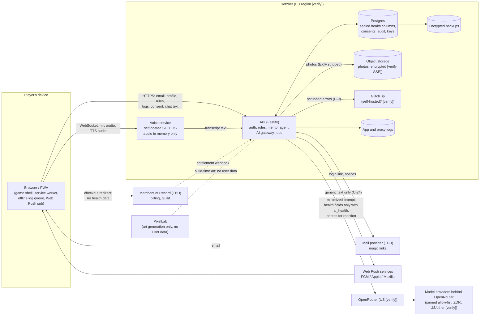

# Kitchen Quest: Personal Data Inventory

**Item:** C-33 (risk assessment and DPIA), first deliverable. Feeds the GDPR Art. 30 record of processing, the DPIA (`dpia.md`) and the risk register (`risk-register.md`).
**Date:** 2026-11-09. **Status:** started at M2; the owner of each later milestone adds that milestone's rows in the same PR as its schema.
**Sources:** `apps/api/src/db/schema.ts` and migrations `0000`–`0014` (built; §6 indexes every column, checked by `apps/api/test/inventory.test.ts`); some M2 rows still read "planned M2" where only part is built; spec §4, §5, §7, §9, §16–§20; `plans/m1-core`, `plans/m2-api`; compliance report §2–§6 (C-ids).
**Caveat:** rows marked "planned" come from the spec and the C-id table, so their column names are proposed, not final; rows marked "built" match the schema (`plans/m1-core` to `plans/m5-loop`). This is not legal advice; **[verify]** marks facts to confirm and **[lawyer]** marks questions for counsel.

## 1. How to read this

**Category:** `identifier`, `health`, `location`, `child`, `usage`, `technical`. Health includes anything that reveals or infers a condition, a disability or a religious diet (GDPR Art. 9 covers both health and religion).

**Basis / consent purpose.** The C-1 purposes are `health_data`, `ai_health`, `voice`, `pantry_location`, `research`. Where no purpose applies, the working basis is shown: **contract** (GDPR Art. 6(1)(b), service the player asked for), **legit.** (Art. 6(1)(f), security and abuse prevention), **legal** (tax, breach duties). For US state health laws the "necessary to provide the requested service" exception may cover some collection **[lawyer: how far]**, so the plan is to take `health_data` consent for all of it.

**Sealed.** `S-U` = AES-256-GCM at the application layer under the per-user data key, with AAD = header + table + user id + row id (C-2/C-3/C-4). `S-1` = today's single `DATA_KEY` sealing (`apps/api/src/crypto/seal.ts`). `hash` = only a hash is stored. `no` = plaintext in a column or file.

**Export / delete.** "E" = in `GET /me/export` (C-7). "D" = removed by `DELETE /me` (C-8), counting crypto-shredding for backups (C-4). Where either is not yet covered it says so.

**Status:** `built`, `planned M-n` (a milestone plan or spec section commits to it), `proposed` (this inventory proposes it; not in any plan yet).

## 2. Data-flow diagram

Trust boundaries: device to API, API to every third party. Everything left of OpenRouter, mail, push, the Merchant of Record and PixelLab is under our control. The edges into those four are where C-13/C-14, C-24 and C-34 apply.

## 3. Inventory

### 3.1 Account and authentication

| ID | Element | Where | Category | Basis / purpose | Sealed | Retention | Processors | E / D | Status |
|---|---|---|---|---|---|---|---|---|---|
| A-1 | Email address | `users.email` (citext, unique) | identifier | contract | no (needed for lookup) | life of account | Hetzner; mail provider | E, D | built |
| A-2 | Email address of sign-in attempts, including people who never become users | `login_tokens.email` (no FK to `users`) | identifier | contract / legit. | no | 24 h after expiry or use (C-6) | Hetzner | not in E; **D only via C-8 (delete by email)** | built; retention planned M2 |
| A-3 | Login token | `login_tokens.token_hash` | technical | legit. (security) | hash | as A-2 | Hetzner | no / D via A-2 | built |
| A-4 | Age confirmation timestamp ("I'm 16+") | `users.age_confirmed_at` | identifier (age attestation) | contract; COPPA/age gate **[lawyer]** | no | life of account | Hetzner | E, D | built; C-39 may change the screen but keeps only this column |
| A-5 | Account creation time | `users.created_at` | usage | contract | no | life of account | Hetzner | E, D | built |
| A-6 | Session token | `sessions.token_hash`, `user_id`, `expires_at`, `created_at` | technical | contract / legit. | hash | delete at expiry (30 d) (C-6) | Hetzner | D | built; retention planned M2 |
| A-7 | Session cookie | browser cookie (`HttpOnly; Secure; SameSite=Lax`) | technical | contract | n/a | 30 d | none | n/a | built |
| A-8 | IP address (IPv4, or IPv6 cut to its /64) in the sign-in rate limiter | API process memory only (`SlidingWindowLimiter` in `apps/api/src/auth/rate-limit.ts`): never written to disk, the database or a log; lost on restart; per instance | identifier (IP) / technical | legit. (abuse, security) | no | each hit is dropped when it leaves the 1 h window; a key with no hits left goes at the next sweep (every minute, on a timer), so **at most 1 h 1 min after the last request** (N-2) | Hetzner (host memory) | not in E (not linked to an account); D by expiry | built (N-2). IPs and user agents in the reverse-proxy log: L-3 |
| A-12 | Email address in the per-email sign-in rate limiter | API process memory only, keyed by the lowercased address, as A-8 | identifier | legit. (abuse) | no | as A-8: at most 1 h 1 min after the last request | Hetzner (host memory) | not in E; D by expiry (an account delete does not wait for it: the entry holds no account link) | built (N-2) |
| A-13 | User id in the account-export limiter (5 exports per hour) | API process memory only, keyed by `users.id`, as A-8 | identifier (pseudonymous) | legit. (abuse; an export decrypts every rule) | no | as A-8: at most 1 h 1 min after the last export | Hetzner (host memory) | not in E; D by expiry | built (Step 7; N-2) |
| A-14 | IP address (as A-8) in the ingredient-search limiter (120 searches a minute; the search needs no sign-in) | API process memory only, keyed as A-8 | identifier (IP) / technical | legit. (abuse) | no | each hit leaves the 1 min window; the key goes at the next sweep, so **at most 2 min after the last search** | Hetzner (host memory) | not in E; D by expiry | built (M-5) |
| A-15 | User id in the recipe-read limiter (120 list or detail requests a minute; each decrypts every rule) | API process memory only, keyed by `users.id`, as A-8 | identifier (pseudonymous) | legit. (abuse) | no | as A-14: at most 2 min after the last request | Hetzner (host memory) | not in E; D by expiry | built (M-5) |
| A-16 | Health-data erasure id (M7 Step 7, M6 fix review N1): a random UUID, new on every `health_data` delete (a withdraw-with-delete or "delete health data now" that removed anything), null before the first | `users.health_erasure` (a uuid; no time, no count; not a foreign key) | technical (says only that some erasure happened, which the J-4 `health_data.delete` audit row already records) | legit. (carrying out the player's Art. 17 erasure on their other devices) | no | life of account; replaced on the next delete; gone with the account | Hetzner | E (not exported: it is no data about the player, only a sync signal), D (cascade with the account) | **built M7** (Step 7). `GET /progress` and `POST /progress/events` return it as `healthErasure`; a signed-in device reads it before any upload and, on an id it has not acted on, erases its own copy of the account's stall rounds and meal-log events (L-5) and keeps the id in that account's partition; every post carries the device's last id, and stall rounds posted with an older id (or none) are refused `erased` and never stored (fix round 1, I1; fix round 2, R1: stall rounds only) |
| A-9 | Session list / device label for "sign out everywhere" | `sessions` (extend) | technical | legit. | no | with A-6 | Hetzner | E, D | planned M2 (C-10b, optional) |
| A-10 | Email as held by the mail provider (recipient, delivery logs, suppression list) | mail provider (TBD) | identifier | contract | provider-side | target <= 30 d, set at the provider (`mail-provider.md`) | mail provider | D: processor-deletion queue (C-8) | planned M2/M12 (provider not chosen); settings required in `mail-provider.md` (N-1) |
| A-11 | Magic-link token inside the email body | mail provider copy of the message | technical (credential) | contract | hash at rest in our DB only | provider-side; the link is dead after 15 min or one use | mail provider | n/a | built (`SmtpMailer`): one `text/plain` part, no HTML, exactly one URL and no health content, tested (`test/mailer.test.ts`, `test/auth.test.ts`); provider-side tracking and rewriting off per `mail-provider.md` (N-1) |

### 3.2 Profile and settings

| ID | Element | Where | Category | Basis / purpose | Sealed | Retention | Processors | E / D | Status |
|---|---|---|---|---|---|---|---|---|---|
| P-1 | Country, region | `profiles.country`, `profiles.region` | location (coarse) | contract; used for seasonality and region gating (C-44) | no | life of account | Hetzner | E, D | built. **M6 (Steps 2, 9–11, C32):** resolved for seasonality **by code only**: core `seasonRegionFor` matches the player's own country and region against the curated `data/seasonality.yaml` (one region, `pnw-usa`), on the device for the stall round and the Season's Table notes; no match or more than one gives `null` ("Washington" alone could be DC, so it is null), and then no seasonal round or note is shown and `market.no_calendar` says so. No default region, no default hemisphere, no fallback to another country's calendar. The country also scopes country-specific label questions (`countries:`, `normalizeCountry`). Never added to a prompt: M4's `PromptContext.profile.region` is the only region a prompt carries and is unchanged, and M6 adds nothing region-derived (no season region id, category or seasonal answer); never in a URL (P-5) or a log. A sealed seasonal round's question ids name the region and month (U-5) |
| P-2 | Market days, meals per week | `profiles.market_days`, `profiles.meals_per_week` | usage | contract | no | life of account | Hetzner | E, D | built |
| P-3 | Meal windows (name, start, end) | `profiles.meal_windows` (jsonb) | usage. The name is one of `breakfast`, `lunch`, `dinner`, `snack`, `other` (N-7), so it cannot spell out a fast or a condition; a name stored before N-7 reads back and exports as `other`; times alone could still hint at a fast | contract; **[lawyer]** whether `health_data` | no | life of account | Hetzner | E, D | built. N-7 ruling: names are a fixed set, not free text (Step 9) |
| P-4 | Reminder times, push preferences | `profiles` or `reminders` | usage | contract | no | life of account | Hetzner | E, D | planned M9 |
| P-5 | Voice accessibility need: the player's self-declared need for voice (motor, vision, dyslexia and similar), which makes voice unmetered (spec §16; business doc §B.11). No proof is asked and no reason is stored | `voice_settings` (`voice_settings.user_id` (primary key, one row per player; a foreign key to `users` **on delete cascade**), `voice_settings.sealed` (`{ accessibility: boolean }` padded to 64 bytes, sealed S-U with AAD `{ table: 'voice_settings', userId, rowId: userId }`; the check `voice_settings_sealed_check` pins the sealed layout and length, so a plain value is refused and `true` and `false` have one length), `voice_settings.updated_at` (from the app's clock)). Never a plain column and never an entitlement: the `accessibility_voice` entitlement kind is retired (`grant` and `npm run grant` refuse it, migration 0022 deleted any row, `entitlements_retired_kind_check` refuses new ones) | **health** (implies a disability: GDPR Art. 9, WA MHMDA consumer health data) (C-19, README Ruling 6) | `health_data` (403 `consent_required` on `PUT /voice/accessibility`; the game shows Form 3-C inline). Counted only while `health_data` is in force: after a "keep" withdrawal the row stays but is not read, and voice is the free allowance. **[lawyer]** counsel may prefer "necessary for the service" (an accommodation the player asked for) as the basis, so that declining `health_data` does not cost a disabled player unmetered voice (Ruling 6, founder/lawyer item) | **S-U** | life of account; **kept once touched, with a sealed `false` when off** (B4), so the row's existence and size say nothing; deleted by a `health_data` withdraw-with-delete (after `HEALTH_TABLES`) and by account delete (cascade, and its data key goes with it) | Hetzner (ciphertext only) | E (`voice: { accessibility, updatedAt }`, decrypted; null when never touched), D | **built M7** (Step 4). The audit event is the neutral `voice.settings` (fix round 1, m5), with no value and no `target`; the logger writes the route pattern only, and on and off log the same lines (tested). Never in a prompt, a log, analytics, a URL or the voice service. `GET /voice/status` reports it as `accessibility` (true only with `health_data` in force) and counts a self-read `voice` while `health_data` is in force (C-5, J-8), whether or not a row exists. Turning it off also needs `health_data`; after a "keep" withdrawal the kept row is not read, and a withdraw-with-delete removes it (m8). 60 voice status requests a minute per player |
| P-6 | Calorie display toggle and other UI settings | `profiles` (extend) | usage | contract | no | life of account | Hetzner | E, D | proposed. Hidden calorie toggle could imply a disordered-eating history; keep it out of AI prompts and analytics |
| P-7 | Notice acknowledgements (policy version seen) | `consents` | usage | legal | no | with consent rows | Hetzner | E, D (pseudonymized if kept, see J-1) | planned M2 |

### 3.3 Health data (the core)

| ID | Element | Where | Category | Basis / purpose | Sealed | Retention | Processors | E / D | Status |
|---|---|---|---|---|---|---|---|---|---|
| H-1 | Allergy and diet rules: target ids, type, severity, limit, phase, journey id | `rules.sealed` (blob; row id = rule id) | health (allergies, intolerances); religious diets are Art. 9 religion | `health_data` | **S-1 today**; S-U with AAD when Step 2c lands (C-3/C-4) | until user deletes the rule or account | Hetzner (ciphertext only) | E (decrypted), D | built. At most **200 rules per player** (M-5): one more is 400 `too_many_rules`; editing and deleting still work at the cap |
| H-2 | Rule free-text `note` ("the user's own words"), and the short free strings `limit.unit` and `phase.journeyId` | inside `rules.sealed` | health or any special category (religion, disability, third-party facts) | `health_data` | as H-1 | as H-1 | as H-1 | E, D | built. Capped (N-7): `note` 500, `limit.unit` 32, `phase.journeyId` 64 characters (§3.13) |
| H-3 | Rule metadata: owner, created and updated time, write version | `rules.user_id`, `created_at`, `updated_at`, `rules.version` (a counter, +1 per update; `PUT /rules/:id` with `If-Match` writes only over the version read, M4 final N4) | usage (reveals that the user has at least one rule and when it changed) | `health_data` | no | as H-1 | Hetzner | E, D | built. Row count is itself weakly sensitive |
| H-4 | Ingredient and category targets resolved by AI during rule expansion | AI request (only the typed term); result saved in H-1 | health | `ai_health` | n/a in transit; then H-1 | not retained by us; provider ZDR | OpenRouter, model provider | covered via H-1 | planned M8 (C-22) |
| H-5 | Diet journeys and enrollments (e.g. low-FODMAP, custom journeys: name, phases, rule sets) | `journeys`, `journey_enrollments` | health (journey implies condition) | `health_data` | S-U (C-23) | until deleted | Hetzner | E, D | planned M9 |
| H-6 | Symptom check-ins: symptom names, 0 to 3 scores, free-text note, date | `symptom_checkins` | health | `health_data` | S-U (C-23); date may stay plain | until deleted | Hetzner | E, D | planned M9 |
| H-7 | Meal logs: dish (canon slug and servings eaten) or free-form description, the date eaten and the slot | `meal_logs` (`meal_logs.sealed` is core's `MealItem`, sealed S-U with AAD `{ table: 'meal_logs', userId, rowId }`; `meal_logs.id`, `meal_logs.user_id`, `meal_logs.eaten_on`, `meal_logs.slot`, `meal_logs.created_at` plain) | health (nutrition; infers conditions) | `health_data` (403 `consent_required` without it; `confirmed: true` on every write) | S-U (C-23); date and slot stay plain (needed for range reads and the mentor's "already logged" context) | until the player deletes the log, withdraws `health_data` with "delete" (`HEALTH_TABLES`), or deletes the account | Hetzner (ciphertext only) | E (decrypted), D | **built M4** (Step 5), minimal: no nutrition numbers or estimates yet (M9). Logged dates must be within 7 days before and 1 day after today; free description capped (§3.13). **Abuse limit** (ruling M-4): at most 200 logs per player per rolling day, identical for every plan and never a paid feature (`usage/write-cap.ts`; 429 with `write.daily_limit`) |
| H-8 | Nutrition snapshots and weekly aggregates | `nutrition_snapshots` or computed | health (derived) | `health_data` | S-U if stored (derived data is still health data) | rebuild on demand preferred; else as H-7 | Hetzner | E, D | planned M5/M9 |
| H-9 | Low-intake check-in | **computed on the fly, never stored as a label** (C-27) | health inference | `health_data` | n/a | none | none | n/a | planned M9; control is the absence of data |
| H-10 | Body metrics (weight etc.) | not designed | health | `health_data` + separate opt-in | S-U | n/a | n/a | n/a | out of v1 (spec §5); listed so nobody adds it without a DPIA update |
| H-11 | Pantry items (with purchase date and source, M5), the weekly meal plan and its market run | `pantry_items` (`pantry_items.sealed` is core's `PantryItem`: name, ingredient id and, from M5 (Ruling 12), the local purchase date `addedOn` and `source` (`told` or `market`) when set, sealed S-U with AAD `{ table: 'pantry_items', userId, rowId }`; `pantry_items.id`, `pantry_items.user_id`, `pantry_items.created_at` plain). `meal_plans` (`meal_plans.sealed` is core's `Plan` minus `weekStart`: per day 0–6 a dish slug and servings or a lesson slug, the hard-week flag and the One More Technique slot state (an offered week also holds the offered technique id and dish slug, M5 final review m1); no free text (strict shape), sealed S-U with AAD `{ table: 'meal_plans', userId, rowId }`; `meal_plans.id`, `meal_plans.user_id`, `meal_plans.week_start` (a date only: needed for the lookup and the retention job), `meal_plans.created_at`, `meal_plans.updated_at` plain; one row per player and plan week). `market_runs` (`market_runs.sealed` is `{ items: ListItem[], pantryIds }`: each list row's ingredient name and id, stall, the plan dishes needing it, the dishes it is a rules-engine swap for, whether it is unverified (❓), whether it is ticked, from M6 (Step 6) its **amounts** (quantity and unit per unit family, scaled to the plan's servings) and its **stock state** (`outOfStock`; a stall swap's own row keyed `stock:<ingredient id>` naming the row it stands in for), and the pantry row id each tick and each stall swap added, sealed S-U with AAD `{ table: 'market_runs', userId, rowId }`; `market_runs.id`, `market_runs.user_id`, `market_runs.plan_id` (cascade with its plan), `market_runs.done_at`, `market_runs.created_at` plain; one run per plan) | pantry: usage; contents can imply diet or condition (gluten-free staples). **Plans and market runs: treated as health data** (M5 Step 6 ruling, conservative): the dishes chosen, and the swaps a market list names ("oat milk, for parippu, swapped") and the dishes it leaves off, can reveal a diet, a religion, an allergy or a condition (GDPR Art. 9, WA MHMDA consumer health data). **[lawyer]** confirm; if counsel rules them contract like the pantry, `meal_plans` leaves `HEALTH_TABLES` and the write gate goes (data only) | pantry: contract (**[lawyer]** whether `health_data`); no consent, every change needs `confirmed: true`. Plans and runs: `health_data` (403 `consent_required` on every write: plan save, run open, tick, finish; reading and deleting need none, so kept data stays readable and deletable after a "keep" withdrawal: `POST /market-runs` without `health_data` returns an existing run computed now and writes nothing); a plan save and a finish need `confirmed: true`, a tick and a stall swap (`POST /market-runs/:id/stock`, M6) don't (§7.0 "None (undoable)"; `undo` is the undo), and a stall swap needs `health_data` like a tick | S-U (pantry, plans, runs) | pantry: until the player removes the item or deletes the account; a `health_data` withdrawal keeps it (not in `HEALTH_TABLES`). Plans and runs: **8 weeks after the plan week ends** (`PLAN_RETENTION_WEEKS`, C-6 job: `week_start` + 7 + 56 days), or when the player deletes the plan (`DELETE /plans/:weekStart`, the run goes with it), withdraws `health_data` with "delete" (`HEALTH_TABLES`), or deletes the account (cascade). Pantry rows a tick added stay with the pantry | Hetzner (ciphertext only) | E (decrypted: `pantry` with `addedOn`/`source`, `plans`, `marketRuns` with `pantryIds`), D | `pantry_items` **built M4** (Step 5), dated **M5** (Step 6): at most **300 items per player** (one more is 400 `too_many_items`), `addedOn` within [today − 60, today + 1]. `meal_plans` and `market_runs` **built M5** (Step 6): at most 21 plan items (`MAX_PLAN_ITEMS`); every plan item and list row is checked by the rules engine on each read and write: a plan's checks are computed on every `GET /plans/current` and save (a ⛔ dish is refused, 400 `plan_invalid`; ❓ is saved and always shown as ❓), and a run's unticked rows are recomputed on every open and every tick, so a dish the rules now block lists nothing and its rows cannot be ticked into the pantry (404). Plans only for the current plan week − 1 to + 4 (400 `plan_invalid`). "Today" is the player's local date, sent by the client as `today` and accepted within a day of the server's UTC date (else 400); without it the UTC date; 120 week requests a minute per player and the M4 daily write cap (200 a rolling day, identical for every plan); audit rows are content-free (`plan.save`, `plan.restore`, `plan.delete`, `market_run.create`, `market_run.finish`, `market_run.stock` (the run's stall-swap count only), and a tick's or a swap's `pantry.change`). **M6 (Step 6):** a stall swap is offered and taken only when core `stockSwaps`, run by the server with the player's rules now (never the client's list), says every dish it serves checks ✅ or 🔁 with it (400 `stock_invalid` otherwise); at most 21 stall swaps a run (`MAX_STOCK_SWAPS_PER_RUN`); a swap's pantry row is removed by id on undo, never by name; a recompute keeps stall-swap rows and the out-of-stock mark of every row it keeps; nothing about food is in a URL or a log. Household sharing M9 |
| H-12 | Margin notes: the player's own changes to a canon recipe (add, swap and remove ops over ingredient names) and their own words about it. Private recipes (Cooklang) remain planned (M8+) | `margin_notes` (`margin_notes.sealed` is core's whole `MarginNote`: `{ recipe, ops, text, at }`, the canon slug, the ops' ingredient names (each 1–80 characters, at most 12 ops), the player's own words (at most 280 characters, `NOTE_TEXT_MAX`) and when it was written, sealed S-U with AAD `{ table: 'margin_notes', userId, rowId }`; `margin_notes.id`, `margin_notes.user_id`, `margin_notes.created_at` plain; the recipe slug is sealed too (Step 7 fix round 1, I1, no keyed hash), so no plain column says which dish a player changed or how often) | **health** (Ruling 9): a swap or a word ("no milk, used oat") can show an allergy, a condition or a religious rule (GDPR Art. 9, WA MHMDA consumer health data) | `health_data` (403 `consent_required` on a write; `confirmed: true` on every write; reading and deleting need none, so kept notes stay readable and deletable after a "keep" withdrawal). Named in the `health_data` notice v3 | S-U | until the player deletes the note (`DELETE /notes/:id`), withdraws `health_data` with "delete" (`HEALTH_TABLES`), or deletes the account (cascade) | Hetzner (ciphertext only) | E (decrypted, `marginNotes`), D | **built M5** (Step 7). At most **20 notes per recipe** (`MAX_NOTES_PER_RECIPE`; one more is 400 `too_many_notes`), counted over the player's own notes opened under the `book:` advisory lock (the slug is sealed, so there is no per-recipe index); no notes on a `sacred: true` recipe (audit M-5). **`GET /notes` takes no recipe in its URL, and no query at all (400): it returns all of the player's notes (at most 20 per recipe) and the client filters by recipe** (P-5, Ruling 26, C32). `POST /notes` returns the rules engine's "cook with my notes" check (core `checkWithNotes`: every change applied and every ingredient the notes name anywhere, the worst status); a read returns no status, the client runs the same core check. Notes never feed a reward and never enter a prompt (C-13). The note's `at` must be within a day of the player's local `today` (sent by the client, within a day of UTC). 60 book requests a minute per player and the M4 daily write cap (200 a rolling day, identical for every plan); audit rows are content-free (`notes.create`, `notes.delete`, the row id only). `GET /notes` counts a self-read `notes` (C-5) |
| H-13 | "Cooked for Someone" (the Shared Table): that the player shared a meal, how many ate, and optionally one fixed word for who | `shared_table` (`shared_table.sealed` is `{ recipe, frame, cookedFor }`: the canon slug or Pantry Frame id cooked, and core's `CookedFor`, a count from `just_me`, `one`, `two_to_three`, `four_plus` and optionally one word from `partner`, `family`, `flatmate`, `friends`, `neighbours`, `colleagues`, `guests`, sealed S-U with AAD `{ table: 'shared_table', userId, rowId }`; `shared_table.id`, `shared_table.user_id`, `shared_table.cooked_on` (a date only), `shared_table.created_at` plain) | usage; about third parties only as a count and a fixed relationship word: **no name, no contact, no free text and no health fact about anyone can be stored** (Ruling 10, R-19, N-7) | contract (not health; not in `HEALTH_TABLES`, so a `health_data` withdrawal keeps it); `confirmed: true` on every write | S-U | until the player deletes the entry (`DELETE /shared-table/:id`) or the account (cascade) | Hetzner (ciphertext only) | E (decrypted, `sharedTable`), D | **built M5** (Step 7). The write's strict shape refuses any other key and any string beyond a canon slug or frame id (400, nothing stored; the error names the field, never the value); exactly one of a non-sacred recipe or a frame; `cookedOn` within [today − 7, today]. `GET /shared-table/tally` returns counts only, `{ shared, byRecipe }`, never a list of entries or people (C21). Never a requirement for, or an input to, trust, progress or a gate (audit M-9); `just_me` gets equal warmth and is not counted as shared. A typed answer is read by core `parseCookedFor` on the device, names dropped before anything is built. Same rate limit and daily write cap as H-12, shared with it and serialized per player by the `book:` advisory lock (fix round 1, M1); a body with any unknown key is 400 naming only the field, never the key or value (M2); audit rows `shared_table.create`, `shared_table.delete` |
| H-14 | Household Kitchen membership and sharing opt-ins | `households`, `household_members` | usage; sharing flags can reveal a member's rules | `health_data` per member (C-25) | per-member S-U | until member leaves or deletes | Hetzner | E (own data only), D | planned M9 |
| H-15 | Clinician share artefact (expiring link or PDF) | `shares` (token hash, expiry, scope) and the generated report | health | `health_data` and the player's own action | token as hash; report content generated on demand, not stored if possible | 7 d default, revocable (C-26) | Hetzner | E (share log), D | planned M9 or later |

### 3.4 AI requests and conversations

| ID | Element | Where | Category | Basis / purpose | Sealed | Retention | Processors | E / D | Status |
|---|---|---|---|---|---|---|---|---|---|
| I-1 | Mentor and NPC conversation transcripts (text and voice transcripts) | `conversations` (content-free: `conversations.id`, `conversations.user_id`, `conversations.started_at`, `conversations.last_turn_at`, `conversations.turn_seq`, `conversations.last_turn_key`: the last turn's client-made random UUID, content-free, so a retried turn is processed once, M4 final J2) and `messages` (`messages.sealed` is the mentor's `StoredMessage`, the player's text or the Pan's reply parts and proposal ids, sealed S-U with AAD `{ table: 'messages', userId, rowId }`; `messages.id`, `messages.conversation_id`, `messages.user_id`, `messages.seq`, `messages.role`, `messages.created_at` plain). Without `health_data` the history is held in API memory only (`MemoryHistory`: at most 8 messages, 30 minutes after the last, never on disk) and no `messages` row is written | health (free text reveals allergies, symptoms, meals); possibly religion and third parties | `health_data` (notices v2 and v3 name it; without it nothing is stored); `ai_health` for the AI leg | S-U (C-12) | `messages` **30 days** after written, `conversations` 30 days after the last turn (C-6 job); user-clearable ("forget this conversation", which hard-deletes the conversation, its messages and its proposals); a `health_data` withdrawal with "delete" removes `messages` (`HEALTH_TABLES`; the content-free `conversations` stay, P-14) | Hetzner (ciphertext only) | E (decrypted), D | **built M4** (Step 6; the turn and forget routes, Step 7) |
| I-2 | The AI request body: persona, style guide, compact player context, tool definitions, user turn | HTTPS to OpenRouter, then the model provider. **Not stored by us** (C-15) | health when it carries rules, severities, symptoms, journey phase or meal text; otherwise usage | `ai_health` for health fields; contract for the rest | TLS in transit; no prompt logging | provider ZDR required (C-14); we keep none | OpenRouter, model providers | n/a (not stored by us); processor list in E | **built M4** (Steps 4, 7): `buildRequestBody` pins `data_collection: "deny"`, `zdr: true` and the provider allow-list; health turns reach the model only with `ai_health`; the model is offered `propose_*` tools only and its text is never shown or stored (R9). Production refuses AI until the DPA is signed (P-11) |
| I-3 | Prompt context for non-consenting users | same | usage only | contract | n/a | n/a | OpenRouter | n/a | **built M4** (Step 7, C-13): without `ai_health` health turns never reach the model, and other turns carry no rules, meals, pantry or health history (`minimiseHistory`); tests assert no rule names or ids in the prompt |
| I-4 | AI response, tool calls and proposed writes | the response in memory only (C-15); each proposal card the server shows is a `mentor_proposals` row (`mentor_proposals.sealed` is core's `ProposalCard`, sealed S-U with AAD `{ table: 'mentor_proposals', userId, rowId }`; `mentor_proposals.undo_sealed` the confirmed write's undo payload under `{ table: 'mentor_proposals.undo', userId, rowId }`; `mentor_proposals.id`, `mentor_proposals.user_id`, `mentor_proposals.conversation_id`, `mentor_proposals.turn_seq`, `mentor_proposals.kind`, `mentor_proposals.severe`, `mentor_proposals.status`, `mentor_proposals.write_ref`, `mentor_proposals.channel`, `mentor_proposals.created_at`, `mentor_proposals.expires_at`, `mentor_proposals.decided_at` plain); confirmed writes land in H-1, H-7, H-11 or the profile | health (a rule, meal, plan or check-off card) | as I-2; the stored card needs no extra consent, the write it guards does | S-U | open for 30 minutes (`PROPOSAL_TTL_MS`). An **undecided** card (open or expired) is deleted as soon as `expires_at` passes (C-6 job, at most an hour late; the user's next card also purges their expired ones). A **decided** card (confirmed, rejected, undone) is kept **24 hours** after it was made, for the 5-minute undo window (`UNDO_WINDOW_MS`) and the audit trail, then deleted. Also deleted on forget, on a `health_data` withdrawal with "delete" (`HEALTH_TABLES`) and with the account. **[lawyer]** a check-off card is held, sealed, for up to 30 minutes for a player whose `health_data` was withdrawn with keep (below); rule, meal and plan cards are never made without it. **M6 Step 8 (check-off cards, `kind = 'check_off'`):** a check-off card, from the closed grammar or the model's `propose_check_off`, is stored pending in the same way for a player whose `health_data` is withdrawn with "keep" (spec Step 8: "shown pending with `consent.health_first`, and ticks on the tap after consent"). It holds only the run id, row keys and a summary copied from the kept, sealed market run (H-11: the run's own row names, never the player's or the model's words). Nothing ticks without `health_data`; it expires or is deleted as above, and a withdraw-with-delete erases it with the run. Unlike rule, meal and plan cards, which are never made without `health_data` (`consent.health_first` only), this is deliberate per the spec. **[lawyer]** confirm (ROADMAP, M6 check-off) | Hetzner (ciphertext only); OpenRouter for the response | E (card decrypted, with status; not the undo payload), D | **built M4** (Step 6); Step 8's guard reads it |
| I-5 | Recipe ingestion input: pasted text, caption, screenshot, URL | AI request; fetched page | usage (may carry personal notes) | contract | n/a; not stored beyond the draft | draft until confirmed or discarded | OpenRouter; fetched site (receives our server IP only, C-21) | E (resulting recipe), D | planned M8 |
| I-6 | NPC Q&A turns | as I-1 | health when grounded with rules | `ai_health` | S-U | as I-1 | OpenRouter | E, D | planned M8 |
| I-7 | Failed-request queue (retry queue for AI calls): **no server queue (N-4)** | **none on the server** (M4 Ruling 9, pre-flight C23): the game retries a failed turn once, in browser memory only, then offers "Try again"; nothing is queued or stored by the API | health (the unsent message) | as I-2 | n/a (nothing stored) | until the retry or the page closes | none | n/a | **built M4** (Step 10): no server-side queue (N-4). A later queue must be sealed or hold no content (R-14) |
| I-8 | Evaluation sets | repo `evals/` | none if synthetic | n/a | n/a | n/a | none | n/a | planned M8 (C-15: synthetic or contributor-consented only) |

### 3.5 Voice

| ID | Element | Where | Category | Basis / purpose | Sealed | Retention | Processors | E / D | Status |
|---|---|---|---|---|---|---|---|---|---|
| V-1 | Microphone audio stream | browser → API voice socket (`GET /voice`, same-origin `/api/voice`, TLS) → the private voice service (`VOICE_SERVICE_URL`: wss:// or a private address in production); **memory only** on both hops: the API decodes each 20 ms frame, forwards it and zeroes it, and keeps no reference | identifier-adjacent (voice) and health content; biometric only if voiceprints were derived, which P-7 bans | `voice` (notice v1, `docs/compliance/notices/voice-v1.md`, M7 Step 4: grants under the inline `2026-11-09` text no longer count); checked at every socket open (4412 `consent_required`) | n/a | none (C-18: the service's test and the API's `voice-memory-only.test.ts` compare directory snapshots, spy on fs writes and run apps/voice's shared PCM detectors over every log line, with a leaking positive control) | Hetzner (voice host; GPU host if different, DPA). Production refuses `VOICE_ENABLED=true` until `processors.json` lists `hetzner` as signed (P-11) | n/a | **built M7** (service Steps 2–3; the API route Step 5). The voice service gets no user id (C-15). Signed-in players only (Ruling 8); never children or Family Table (per-user block, V-5) |
| V-2 | Partial and final STT transcripts | in memory, then I-1. The API's voice socket keeps its own last 4 final transcripts in that socket's memory, only to speak a heard card back (`heard` speak items, Ruling 15), and drops them when the socket closes; it sends a transcript to the device only if core `parseTurnInput` takes it (over MAX_TEXT → `too_long`, never cut) | as I-1 | `voice` + `health_data` | S-U once stored | as I-1; partials never logged; the socket's copies until it closes | Hetzner | E, D | **built M7** (Step 5: the socket; Step 6 stores them as turns). Never logged: the route logs kinds and statuses only (Review Focus 2, tested) |
| V-3 | TTS output audio | generated per turn, streamed, not stored. The API renders every spoken line itself from server-held data (`renderSpeak`, Ruling 15: the client sends ids only; every variable passes `filterReply`; anything else is spoken as `voice.check_screen`) and passes the Pan's audio frames through | technical | contract | n/a | none (the service caches scripted, var-free lines' audio in memory only) | Hetzner | n/a | **built M7** (Steps 2–3 and 5) |
| V-5 | The per-user voice block: whether a child flag was set in any of the player's conversations (kept for the child-flag TTL, 30 minutes) and whether their device reported Family Table mode (`PUT /voice/family-table`, `hello.familyTable`) | API memory only (`voice/registry.ts`), never stored, logged or audited | child (that a child may be present) | legit. and §19 (children never talk to the AI; server STT off) | n/a | until the TTL passes or the device clears it; gone on restart (the game reports again at every start) | none | n/a | **built M7** (Step 5, Ruling 17). Closes every voice socket of the player (4451 `child`, 4452 `family_table`) and refuses `hello` and `listen`. **The API runs as exactly one process** while this is in memory (ROADMAP deploy note, a launch blocker for scaling out); a restart clears it. The flag is per player while the setting is per device: per device since M7 Step 9 fix round 2: each report names the reporting install's random device id (L-9), the API keeps the ids of the player's devices in Family Table (`voice/family-devices.ts`, memory only, at most 32 per player), and a device's `{on:false}` removes only its own id, lifting the block only when that empties the set; a device that never reported on (a second device's start-up report) changes nothing, and a `hello.familyTable` block (no id) lasts until some device's on→off or a restart (fail-safe). Sign-out, account delete and a `voice` or `health_data` withdrawal close every voice socket of the player too (fix round 1, I1) |
| V-6 | Recent replies: the written-line parts (trigger and variables) of the player's last 8 mentor replies, so a `reply` speak item is spoken with the server's own variables | API memory only (`voice/recent-replies.ts`), at most 8 per player, 10 minutes each; model text is not held | as I-1 (the variables can name a food or an allergen) | as I-1 | n/a | 10 minutes | none | n/a | **built M7** (Step 5; Step 6's turn fills it and forget or account delete clears it) |
| V-7 | The STT vocabulary hint: the graph's major allergens; with `health_data` also the player's rule targets, pantry names and this week's open market-run rows (at most 60 words) | sent with each `listen` to the self-hosted voice service only, in memory there for the utterance; never stored or logged by either side | health (with `health_data`: rule targets) | `voice`; the health parts need `health_data` (C-13) | n/a | the utterance | Hetzner (voice host) | n/a | **built M7** (Step 5, `voice/hint.ts`) |
| V-4 | Voice usage: seconds of the player's speech and of the Pan's, and their cost, per utterance | `usage_events` (feature `voice_stt`: the player's speech; `voice_tts`: the Pan's; `units` = whole seconds rounded up, `cost_microusd` = units × 25; `created_at`). **Content-free**: no audio, transcript, text, hint, conversation id or millisecond duration; nothing is written for 0 ms | usage (content-free; the time of each utterance shows when the player talked to the Pan) | contract (the allowance, spec §16) | no | 13 months (C-6) | Hetzner | E (per-feature totals, as U-1), D | **built M7** (Step 4, `recordVoice`; Step 5 calls it exactly once per utterance whose `end` went upstream, whatever the outcome (a transcript, a failure, a cancel or a replace after `end`, the socket closed), except the service down or timing out; written before the answer is sent and before the next listen reads the allowance (fix round 1, I2, m3). An utterance cancelled while still listening, and a cancelled speech, are not recorded; each finished speech is). Only `voice_stt` counts toward the allowance (Ruling 5); `voice_tts` is recorded, never counted. The allowance is shown only as a state (`available`, `resting` until a date, `resting_today`): no number, countdown or Guild mention. The date and "today" are the player's own calendar date, from the `localDate` and `localTime` the game sends with `GET /voice/status` (M7 Step 4 fix round 1, I1; never stored or logged) |

### 3.6 Photos

| ID | Element | Where | Category | Basis / purpose | Sealed | Retention | Processors | E / D | Status |
|---|---|---|---|---|---|---|---|---|---|
| F-1 | Food photos (Recipe Book, cook session) | Hetzner Object Storage, random object keys; row in `photos` (owner, key, recipe ref) | health when it shows what the player ate; can show faces, kitchens, and with EXIF, location | `health_data` | S-U client-sealed or app-sealed before upload (C-20; SSE support **[verify]**) | until user deletes (Recipe Book) | Hetzner | E (files), D via processor-deletion queue | planned M8 |
| F-2 | EXIF, GPS and device metadata | stripped before storage and before any AI call (C-20) | location, technical | none (not kept) | n/a | none | none | n/a | planned M8; test required |
| F-3 | Photo sent to AI for the cook's reaction | AI request | health | `ai_health` | TLS | provider ZDR | OpenRouter, model provider | n/a | planned M8 |
| F-4 | Face check on upload (family mode) | on device only | child / biometric question | pending counsel | n/a | stores and sends nothing | none | n/a | planned M13 (C-45) **[lawyer]** |

### 3.7 Neighborhood Pantry (location and other people)

| ID | Element | Where | Category | Basis / purpose | Sealed | Retention | Processors | E / D | Status |
|---|---|---|---|---|---|---|---|---|---|
| N-1 | Post: item, portions, made-on and keeps-until, pickup window | `pantry_posts` | usage; reveals diet | `pantry_location` | no (shown to neighbours by design) | deleted after pickup window (C-6, C-28) | Hetzner | E, D | planned M11 |
| N-2 | Approximate area (1 km grid cell, snapped on device) | `pantry_posts.cell` | location | `pantry_location` | no | as N-1 | Hetzner | E, D | planned M11 (C-28) |
| N-3 | Exact pickup spot, shared after acceptance | `pantry_handoffs` | location (precise) | `pantry_location` | S-U, visible only to the two parties | deleted at end of window | Hetzner | E, D | planned M11 |
| N-4 | Allergen tags and ingredient list on a post | `pantry_posts` | health-adjacent (of the poster's dish, not of the poster) | `pantry_location` | no | as N-1 | Hetzner | E, D | planned M11 |
| N-5 | Display handle or first name for requests | `profiles` (extend) or `pantry_handles` | identifier | `pantry_location` | no | life of account | Hetzner | E, D | planned M11; **new identifier not yet in a plan** |
| N-6 | Requests, messages between neighbours | `pantry_requests` | identifier, usage | `pantry_location` | proposed S-U | deleted with the post | Hetzner | E, D | planned M11; no free-text contact details (spec §18) |
| N-7 | Reports and blocks | `pantry_reports`, `pantry_blocks` | usage; reporter identity hidden from reported user | legit. (safety) | no | 12 months (C-29) | Hetzner | E (the user's own reports), D | planned M11 |
| N-8 | Requester's own status (OK, blocked, unverified) per post | computed on the requester's device | health | n/a (on device) | n/a | none | none | n/a | planned M11 (C-28) |
| N-9 | Static map of community fridges and food banks | public data in repo | none | n/a | n/a | n/a | none | n/a | planned M11. Viewing is not logged per user |

### 3.8 Children (Family Mode, M13)

No child data is collected until counsel signs off (P-9). The rows are reserved so the M5 schema and consent ledger are built for them.

| ID | Element | Where | Category | Basis / purpose | Sealed | Retention | Processors | E / D | Status |
|---|---|---|---|---|---|---|---|---|---|
| K-1 | Child profile: nickname, age band, preset avatar | `child_profiles` | child, identifier | parental explicit consent per child, via `consents(subject_kind='child_profile')` (C-45) | S-U with a per-child key | until deleted (two taps) | Hetzner | E (parent export), D | planned M5 (reserve) / M13 |
| K-2 | Child allergy rules (parent entered) | `child_rules` | child, health | parental explicit consent | sealed with per-child key (C-45) | until deleted | Hetzner | E, D (key shred) | planned M13 |
| K-3 | Child skill progress, cooked-together records | `child_progress` | child, usage | parental consent | proposed S-U | until deleted | Hetzner | E, D | planned M13 |
| K-4 | Parental consent record per child | `consents` (subject fields: `consents.subject_kind`, `consents.subject_id`) | child, legal | legal | no | life of profile plus audit period **[lawyer]** | Hetzner | E, D | **reserved M5** (subject columns, Step 7, Ruling 19, C-45): `consents.subject_kind` is `text not null default 'user'` with a check that allows only `'user'`, and `consents.subject_id` is a nullable uuid, held null by the check `consents_subject_id_check` (`subject_id is null`; M13 replaces it with `(subject_kind = 'user') = (subject_id is null)`). Every row is the account holder's own; no child data is collected and no child table exists (P-9). Export lists both columns with each consent. M13 widens the check and adds `child_profiles` |
| K-5 | Never stored: child intake or nutrition, photos of children, voice, location, birthdays | none | child | n/a | n/a | n/a | n/a | n/a | rule (spec §19, P-9) |

### 3.9 Usage, billing, entitlements

| ID | Element | Where | Category | Basis / purpose | Sealed | Retention | Processors | E / D | Status |
|---|---|---|---|---|---|---|---|---|---|
| U-1 | AI and voice usage events: feature, units, cost, time | `usage_events` | usage (content-free) | contract (allowances) | no | 13 months (C-6) | Hetzner | E (per-feature totals), D | built; retention planned M2. M4 Step 12: a zero-unit `mentor_text` row is written **before** each model call is sent and completed with units and cost on success, so the export can list OpenRouter as a recipient (`inUse`, `sentFrom`/`sentUntil`) even for a call that failed. **[lawyer]** after 13 months the rows are deleted, so a past disclosure older than that is no longer shown in the export's recipients (GDPR Art. 15(1)(c) "have been disclosed"): is a 13-month look-back enough, or should a content-free "ever sent" marker be kept for the account's life? |
| U-7 | The AI's total spend per hour across all players (no user id, no content), for the global daily budget | `ai_cost_hours` (`ai_cost_hours.hour`, `ai_cost_hours.cost_microusd`) | none (aggregate, not personal data) | legit. (cost control) | no | 48 hours (C-6 retention job) | Hetzner | n/a (no subject) | built (M4 Step 7) |
| U-2 | Entitlements: kind, source, start and end | `entitlements` | usage; kind `bursary` or `founding` hints at financial circumstances | contract | no | life of account | Hetzner | E, D | built. See R-18. Never an accessibility need (M7 Step 4, C-19): the `accessibility_voice` kind is retired, and the database refuses it (`entitlements_retired_kind_check`); the need is P-5 |
| U-3 | Billing identity (name, card, address, tax) | at the Merchant of Record only; we store nothing (schema comment: "never holds price, payment or card data") | identifier, financial | contract; legal | provider-side | provider legal retention **[verify]** | Merchant of Record (TBD) | processor list in E; D partly retained by law | planned M12 |
| U-4 | Merchant of Record customer id / subscription id | `entitlements.source` or `billing_links` | identifier | contract | no | life of account | Hetzner, Merchant of Record | E, D | proposed |
| U-5 | Progress (M5, Ruling 7): the content-free facts of play (a recipe read through, a drill, a dish or Pantry Frame cooked, a quest step or quest done, a technique recognized, a market run closed, a meal logged (the local minute and the meal log's random id only, no meal content), an M3 toolkit record imported, and from M6 a **market stall round** (`stall_round`: the stall and each answered question id with its pick), and what each earned (XP, stamps, trust levels, levels, technique certificates), fixed when granted. Levels, trust, stamps and technique tiers and freshness are derived from these two ledgers, never stored | `progress_events` (`progress_events.id`, `progress_events.user_id`, `progress_events.seq` (insertion order), `progress_events.client_id` (the game's event id: **a UUID, enforced** (any other id rejects the event), so no client-chosen text is stored), `progress_events.kind`, `progress_events.at` (the player's local date, 2026-01-01 to today + 1), `progress_events.body` (the rest of core's `ProgressEvent`: canon slugs, quest, technique, frame and cook ids, step numbers, a minute, a week start; strict shape, every id checked against the catalogue, so no free text), `progress_events.meal_log_id` (a `meal_logged` event's meal log, that kind only, one event per log; a foreign key to `meal_logs` **on delete cascade**), `progress_events.sealed` (M6 Step 6: a `stall_round`'s whole body (stall id, question ids, picks), sealed S-U with AAD `{ table: 'progress_events', userId, rowId }`; set for that kind only and always for it (a check constraint), when its `progress_events.body` is `{}`; null for every other kind), `progress_events.created_at`); `reward_grants` (`reward_grants.id`, `reward_grants.user_id`, `reward_grants.event_id` (the event row it was granted for: a plain column, **not** a foreign key, so erasing a meal-log event keeps its grants), `reward_grants.kind`, `reward_grants.body` (core's self-contained `RewardGrant`: its own id, the event's client id (a UUID), the day (`isoDay`), and the amount, stamp, cook and level or technique; never the meal log id, no event content). **No time column**: a grant's only date is its day) | usage; the dish slugs reveal what the player cooked, and `meal_logged` when they ate (**[lawyer]** whether either needs `health_data` as a basis; today `meal_logged` events are accepted only while `health_data` is granted, the gate of `POST /meals`, and the rest is contract, like the pantry). **Stall rounds (M6, Ruling 17):** a Protein Counter round shows the player's rules exclude meat (diet, religion or condition: GDPR Art. 9, WA MHMDA consumer health data), and answered question ids can imply a rule over time, so **every** round is sealed per row and erased by a `health_data` delete; only a round core `isHealthRevealing` names (any Protein Counter question, or one the catalogue doesn't hold) needs `health_data` to be accepted (else `consent_required`, per event). A plain seasonal round's question ids name the region and month (e.g. `wen-pnw-11-squash`): P-1-level coarse location, on the contract basis, sealed, never in a URL or a log. The server stores no list of the questions a round showed, only those answered (inside the seal) | contract (progression, spec §6); `meal_logged` and a health-revealing `stall_round` only with `health_data` | no (plain; content-free ids and numbers), except `progress_events.sealed` (S-U) | life of account. Grants are append-only: no update or delete path, only account delete; from M5 Step 12 a database trigger (`reward_grants_append_only`) refuses any UPDATE, and `never-take-back.test.ts` greps `apps/api/src` for an update or delete of the table. A meal-log undo (`DELETE /meals/:id`) erases that log's `meal_logged` event in the same transaction (the foreign key cascades), and a `health_data` withdraw-with-delete erases every `meal_logged` event and every `stall_round` event (M6 Step 6, Task 3 ruling I2: all rounds, not only the Protein Counter's): no row or content kept. Their grants are kept, so XP, level and stamps never drop (spec §6, I2 ruling), and a kept grant holds kind, amount and day only. **[lawyer]** confirm that keeping those grants (kind, amount, day) after a `health_data` delete is acceptable; the content-free `progress.record` and `meals.create` audit rows (J-4) also keep the time of the post for 24 months | Hetzner | E (`progress.events` (a sealed stall round shown whole, decrypted), `progress.grants` (with `isoDay`), `progress.view`), D (cascade on account delete; both ledgers; a deleted account's data key goes with it, so a sealed round is crypto-shredded) | **built M5** (Step 5). `POST /progress/events` takes at most 100 events a request, at most 60 progress requests a minute per player, and at most 200 recorded posts a rolling day (the M4 write cap, the same for every player and plan; 429 `rate_limited` with `retryAfterSeconds`, which changes nothing already stored); core caps each local day at 200 events (per event, C14). Never read by entitlement code (never rule 3) |
| U-6 | Progress snapshot (M6 Step 7, Ruling 18; M5 m12): a **cache** of the U-5 fold, never a record. Core's `ProgressSnapshot` (the view: XP, level, stamps, trust per cook, toolkit, quests, `cookedOn` dish slugs, frames, `marketAnswered` stall question ids (Protein Counter ones included) with whether each was ever right and its last date; and the facts `grantsFor` reads: event ids seen, events per date, once-keys used, cook-weeks, nourishment counts and minutes) of every event up to `upto_seq` and every grant made for them or for an event already erased. Derived only from U-5, which it never replaces: XP and the rest stay sums and maxima of the grants | `progress_snapshots` (`progress_snapshots.user_id` (primary key, one row per player; a foreign key to `users` **on delete cascade**), `progress_snapshots.upto_seq` (the newest `progress_events.seq` folded), `progress_snapshots.catalogue_hash` (sha256 of the catalogue, `data/rewards.yaml`, the freshness thresholds and core's `FOLD_VERSION` it was folded under; no personal data), `progress_snapshots.sealed` (the snapshot, sealed S-U with AAD `{ table: 'progress_snapshots', userId, rowId: userId }`), `progress_snapshots.created_at`) | as U-5: usage, with the dish slugs and answered stall ids, which can imply a diet or rule (so sealed, like the stall rounds) | as U-5 (derived from it; contract, progression, spec §6) | **yes** (S-U) | while it matches the ledgers: **dropped in the same transaction whenever any of the player's progress events is deleted** (the database trigger `progress_events_drop_snapshot`, `AFTER DELETE ON progress_events FOR EACH ROW`: a meal-log undo's foreign-key cascade, a `health_data` withdraw-with-delete erasing the `meal_logged` and `stall_round` events, anything later), so it never outlives an erased event; ignored and rebuilt when its `catalogue_hash` differs or it won't open (an unreadable one is deleted and logged as a content-free warning); otherwise rewritten once more than `SNAPSHOT_EVERY` (500) events follow it; life of account at most. Written only under the `progress:` advisory lock, after `progress_events` and `reward_grants` (last in the lock order's table order). Never lowers a value: it is core's own C15 fold, and a property test (`never-take-back.test.ts`) pins view(snapshot + tail) = view(full) | Hetzner | E (`progress.snapshot`: `uptoSeq`, `catalogueHash`, `createdAt`, the `view` and `facts` decrypted; or null), D (cascade on account delete; its data key goes with the account, so it is crypto-shredded) | **built M6** (Step 7) |
| U-8 | Contributor share ledger (renumbered from a second U-6 in M6 Step 7) | `contributor_payouts` | identifier, financial | contract | no | legal retention (tax) **[verify]** | payout provider (TBD) | E; D limited by law | proposed, M12+ |

### 3.10 Compliance metadata

| ID | Element | Where | Category | Basis / purpose | Sealed | Retention | Processors | E / D | Status |
|---|---|---|---|---|---|---|---|---|---|
| J-1 | Consent ledger: purpose, notice version, notice sha256, granted, withdrawn, why it ended, method (and later subject) | `consents` (`consents.purpose`, `consents.notice_version`, `consents.notice_sha256`, `consents.granted_at`, `consents.withdrawn_at`, `consents.ended_reason`, `consents.method`) | usage (legal evidence); the existence of a `health_data` consent is itself weakly sensitive | legal (proof of consent) | no | life of account (cascade on delete) **[lawyer]** whether to keep pseudonymized | Hetzner | E (full history), D | built (C-1). The `health_data` notice is `notices/health_data-v3.md` (version `v3` from M5 Step 7, its SHA-256 in each grant); it names religious and cultural diets (N-7), the meals kept and the 30-day Pan conversations (C-12), and, from v3, weekly plans and market lists and margin notes (H-11, H-12). The C-45 subject columns (`consents.subject_kind`, `consents.subject_id`) are reserved: see K-4. The `ai_health` notice is `notices/ai_health-v1.md`. Grants under older versions no longer count |
| J-2 | Per-user wrapped data key | `user_keys(user_id, key_id, wrapped)` | technical | security | wrapped by the ring key | life of account; deletion = crypto-shred | Hetzner | not exported; D | planned M2 (C-4) |
| J-3 | Master key ring | environment (`DATA_KEYS`, `DATA_KEY_ID`), kept out of the repo and the DB backup (C-2) | technical (secret) | security | n/a | rotated yearly and at offboarding | Hetzner host | n/a | planned M2; **today a single `DATA_KEY` in env** |
| J-4 | Audit events: time, actor kind and id, subject, action, target, request id; never content | `audit_events` (append-only) | usage / technical | legit.; legal | no | 24 months; subject pseudonymized (HMAC) on account delete (C-5) | Hetzner | E (where subject), D = pseudonymize | planned M2 |
| J-5 | Retention-job run records | logs or `job_runs` | technical | legit. | no | 90 d proposed | Hetzner | n/a | planned M2 |
| J-6 | Data-rights request log | `audit_events` (action `dsr_*`) plus privacy mailbox | identifier | legal | no | 3 years **[lawyer]** | mail provider; Hetzner | E (own), partly retained | planned M12 (C-31) |
| J-7 | Processor register | `docs/compliance/processors.json` (repo) | none | legal | n/a | n/a | none | E (list, C-7) | built (in the export, Step 7) |
| J-8 | Self-read counters: how many times a day the player read their own rules (`GET /rules`, and `GET /recipes` and `GET /recipes/<slug>`, which decrypt the rules to check recipes (M-6), so the count is honest), meal logs (`GET /meals`, resource `meals`) pantry (`GET /pantry`, resource `pantry`) progress (`GET /progress`, resource `progress`, M5) and the plan (`GET /plans/current`, resource `plans`, M5 Step 6), and the voice accessibility setting (`GET /voice/status` while `health_data` is in force, resource `voice`, M7 Step 4) | `self_read_counts` (`self_read_counts.user_id`, `self_read_counts.resource`, `self_read_counts.day`, `self_read_counts.count`) | usage (content-free; stands in for per-read audit events so no "when they looked" log is built) | legit. (C-5 access accountability) | no | 24 months (C-6 retention job) | Hetzner | E, D (cascade) | built (Step 7) |

### 3.11 Logs, errors, client-side storage

| ID | Element | Where | Category | Basis / purpose | Sealed | Retention | Processors | E / D | Status |
|---|---|---|---|---|---|---|---|---|---|
| L-1 | API request log: method, route **pattern** (`/rules/:id`, `(unmatched)` for unknown paths), status, timing, request id. **No** query string, body, headers, cookies or client address (C-9) | stdout, shipped to host logs | technical | legit. | no | **14 days**, at most 30 (§3.14) | Hetzner | not in E (holds no identifier); D by expiry | built (`apps/api/src/logging/redact.ts`, tested with `captureLogs()`); retention set at the log host (N-2) |
| L-2 | Error reports (stack trace, route, request id; request data, breadcrumbs and email stripped) | GlitchTip | technical | legit. | n/a | **unset, proposed 30 d** | GlitchTip (self-hosted? **[verify]**) | not in E; D by expiry | planned M2 (`before_send`, C-9); 500-path logging already PII-free (commit 439f6d4) |
| L-3 | Reverse-proxy access log | Hetzner host / proxy | technical (IP, URL, user agent) | legit. | no | **14 days**, at most 30 (§3.14) | Hetzner | not in E; D by expiry | planned M12 (C-38); retention registered here (N-2) |
| L-4 | Database and object-storage backups | Hetzner / backup target | all of the above, ciphertext for health | legit. (availability) | health columns stay sealed; whole-backup encryption (C-35) | 30 days (C-35) | Hetzner | D via crypto-shred (C-4) | planned M12 |
| L-5 | Browser storage on the player's device (`localStorage` key `kq.player.v1`; service-worker cache): recipes and content (M6: the lazy market chunk, stalls and the Season's Table, precached for offline practice); signed out, the guest's progress log (M5: content-free events and grants; M6: **stall rounds**, each `{ stall, answers: [{ q, pick }] }` in plain JSON on the device), the week's plan and market list (dish slugs, list rows by ingredient name, a swap and ❓ marks; M6: amounts, out-of-stock marks and stall-swap rows), the pantry and device rules (M3/M4); signed in, each account's own progress partition, and a signed-in meal log's waiting `meal_logged` event | browser storage on the player's device | progress: usage (content-free events and grants); **the device plan and market list: health data**, treated as H-11 treats plans and runs (they reveal diet: Step 6 ruling, `HEALTH_TABLES`); device rules and a waiting `meal_logged` (its local day and minute, and the meal log's random id): health. Margin notes, Cooked for Someone and meal logs are account-only (M5 Step 11). **M6 device stall rounds:** a base round is usage; a **Protein Counter round is health data on the device** (it shows the rules exclude meat, as device rules do: GDPR Art. 9, WA MHMDA), kept like the device rules it follows from; signed in, a health-revealing round moves to the account only under `health_data` (the consent card first; a round the server refuses stays in the guest partition with its grants unshown, Step 9 I1) | contract on the device for the device plan, list, pantry and rules (never sent anywhere without the player's move tap, and then only under `health_data`; never in a prompt, C-13); `health_data` for the waiting meal-log event (it exists only after `POST /meals` under that consent) | no (WebCrypto still proposed, R-12) | **M5 partitions (C1 ruling):** a guest partition and one partition per account, keyed by a SHA-256 of the email, so no storage key holds an email; a partition is read, shown and synced only while its own account is signed in, and never uploaded under another account; guest progress joins an account only after the player taps "Add it to my account" and is then moved (removed from the guest partition). On sign-out the account's synced events are deleted (the server is the record), leaving only unsynced ones until that account signs back in. **M6 final review I1:** a `health_data` withdraw-with-delete also erases the account partition's stall rounds (Protein Counter rounds among them) and meal-log events on this device, synced or not, with the answered question ids a compacted base and the cached account view hold (`marketAnswered`, and the base's stall-stamp keys, which name a stall); their grants stay (kind, amount, day), so XP, level and stamps never drop, as on the server (U-5). **M7 Step 7 (M6 fix review N1, the server erase signal; fix round 1, I1):** every `health_data` delete gives the account a new erasure id (A-16), which `GET /progress` and `POST /progress/events` return. Each of the account's other signed-in devices reads it (`GET /progress`) **before it uploads anything** (sign-in, a retry or reconnect, the guest add) and erases its own copy the same way: stall rounds and meal-log events, synced or still waiting to upload, and the answered ids; it keeps the id with that account's partition so it acts on each erasure once. Rounds recorded before the erasure are therefore dropped on the device, never sent. Every post also carries the id the device last acted on, and the server refuses (`erased`, content-free, nothing stored) any stall round posted with an older id or none, so a live post from a device that has not yet seen the erasure stores none of them either, and its answer makes the device erase (fix round 2, R1: meal-log events are not refused this way; a pre-erasure one names a meal log the delete removed, `unknown_meal_log`, and a later one needs `health_data`). A live round refused this way was recorded just now, so the device applies the new id and posts it once more under it; refused again, it leaves as a record. **Accepted loss (fix round 2 ruling):** a round recorded after a remote erasure but before this device learned of it can be lost as a record, because the device can't order it against the erasure (it carries only a local date); its XP is kept. Conversely, a live round recorded a second or so before a delete made on another device, at the same moment, can still be stored through that one re-post (two devices in use at once; fix round 2 review, accepted, no code change). The grants of rounds erased or refused before they were uploaded stay on the device, through sign-out too (fix round 1, m1), so XP never drops; they hold kind, amount and day only. A device that never reaches the server again keeps its copy until it signs out or "Delete everything on this device" is used; nothing can reach it sooner. A signed-in `meal_logged` stays in that account's partition (`{ id, kind, at, minute, mealLogId }`) **until the server accepts or rejects it**: a whole-request failure other than a 429 keeps it and retries it; it is removed on undo (`DELETE /meals/:id`) and on `unknown_meal_log` (Step 11 fix round 1, Ruling I2). Device weeks (plans and runs) are kept 8 weeks after they end (as H-11): the store prunes them when it loads, on each sign-in and sign-out, and on each device save, always against today's local date (M5 final review I3). Family Table writes none of the loop (Ruling 25) and no stall round, tick, swap, check-off card or stamp (M6, C31) | until synced, until sign-out (synced data), or until "Delete everything on this device" | none | E (server copy once synced; the Recipe Book download is built on the device), D (device: "Delete everything" wipes it; sign-out drops synced progress) | **built M5** (Steps 9–11); **[lawyer]** the device-side wait of a meal log's day and minute (ROADMAP M5); **[lawyer]** keeping a signed-out device plan and list (health data) on the device under contract without `health_data` consent, alongside the device-rules note (R-12, ROADMAP M5); **[lawyer]** the same for signed-out Protein Counter rounds on the device (ROADMAP M6). See R-12 |
| L-6 | Web Push subscription: endpoint URL, keys | `push_subscriptions` | technical, identifier (endpoint is a per-device id) | contract; consent via browser permission | no | until unsubscribe or account delete | Hetzner; FCM, Apple, Mozilla | E, D | planned M9 |
| L-7 | Push payloads | in transit to push service | none by rule: generic text only (C-24) | contract | RFC 8291 encryption | transient | push services | n/a | planned M9; test required |
| L-8 | localStorage / UI state | browser | usage | contract | no | until cleared | none | n/a | planned M4; keep health data out |
| L-9 | The install's device id (M7 Step 9 fix round 2): a random UUID (`crypto.randomUUID()`) | browser storage on the player's device (`localStorage` key `kq.device.v1`); sent only in the body of `PUT /voice/family-table { on, deviceId }`, where the API holds it in memory only, in the per-player set of devices in Family Table (V-5) | technical: an opaque per-install identifier, not derived from anything, never personal data on its own; linked to a person only through the signed-in account it is reported under, and only while that device is in Family Table | legit. (§19 / Ruling 17: the server's Family Table block must be per device) | no | device: until "Delete everything on this device" (it is a `kq.*` key) or the browser's site data is cleared; a new install gets a new id. API: until that device reports `{on:false}`, or a restart (never stored, logged or audited) | none | n/a | **built M7** (Step 9 fix round 2). Strict UUID shape on the API (400 otherwise); used for nothing but the Family Table block; never in a URL, a log, an export or a prompt |

### 3.12 Content that names people

| ID | Element | Where | Category | Basis / purpose | Sealed | Retention | Processors | E / D | Status |
|---|---|---|---|---|---|---|---|---|---|
| W-1 | Recipe contributor ids (stable ids, e.g. GitHub handles) | `recipes/**/*.cook` front matter; `canon_recipes.contributors` (M2 Step 6) | identifier (public, third party) | legit.; contributor agreement | no | as long as the recipe is in the canon | GitHub; Hetzner | not in the player's E; contributor rights handled separately (**gap**) | planned M2 Step 6 |
| W-2 | Recipe source URL and author credit | `canon_recipes.source`, recipe cards | identifier (third party, public) | legit. (credit) | no | as above | Hetzner | n/a | built |
| W-3 | Canon recipe metadata | `canon_recipes` | none | n/a | n/a | n/a | n/a | n/a | built |

### 3.13 Free-text fields and their caps (N-7)

Every string the API accepts from a player, with its maximum. A field not listed here takes no free text. Enforced in the route's zod schema (anything longer is 400 `bad_request` naming the field) or, where a shape is required, by the shape check.

| Field | Where it is stored | Max | Notes |
|---|---|---|---|
| `email` (`POST /auth/request`) | `login_tokens.email`, then `users.email` | 254 | must be an email address |
| `token` (`POST /auth/verify`) | nowhere (hashed and compared) | 43 | must have the shape of an issued token; anything else is 401 like any bad link |
| `country`, `region` (`PUT /profile`) | `profiles.country`, `profiles.region` | 80 each | coarse location only |
| meal-window `name` (`PUT /profile`) | `profiles.meal_windows` | n/a | enum `breakfast`, `lunch`, `dinner`, `snack`, `other`; not free text |
| meal-window `start`, `end` | `profiles.meal_windows` | 5 | `HH:MM` |
| `rule.note` (`POST`/`PUT /rules`) | `rules.sealed` | 500 | sealed (S-U) |
| `rule.limit.unit` | `rules.sealed` | 32 | sealed; core requires a non-empty string |
| `rule.phase.journeyId` | `rules.sealed` | 64 | sealed |
| `rule.phase.start`, `rule.phase.end` | `rules.sealed` | 10 | core requires `YYYY-MM-DD` |
| `rule.target.ids[]` | `rules.sealed` | n/a | each must be an id in the ingredient graph (core) |
| rules per player (`POST /rules`) | `rules` | 200 rows | not a string cap: bounds how much health data one account holds and how much each request decrypts (M-5); 400 `too_many_rules` |
| meal `item.description` (`POST /meals`, free meal) | `meal_logs.sealed` | 200 after trim (core `MEAL_DESCRIPTION_MAX`) | sealed (S-U); at least 1 character after trim |
| meal `item.slug` (dish) | `meal_logs.sealed` | n/a | must be a `canon_recipes.slug` |
| meal `item.servings` (dish) | `meal_logs.sealed` | n/a | a finite number from 0.25 to 10 |
| meal `eatenOn`, `slot` | `meal_logs.eaten_on`, `meal_logs.slot` | 10 / n/a | a real `YYYY-MM-DD` within [today − 7, today + 1]; `slot` is the enum `breakfast`, `lunch`, `dinner`, `snack`, `other` |
| `from`, `to` (`GET /meals`) | nowhere | 10 each | real dates, `from` ≤ `to`, at most 31 days both included |
| pantry `add[].name` (`POST /pantry/changes`) | `pantry_items.sealed` | 80 after trim | sealed (S-U); at least 1 character after trim |
| pantry `add[].ingredientId` | `pantry_items.sealed` | 64 | null or an id in the ingredient graph |
| pantry `removeNames[]`, `removeIds[]` | nowhere (matched, then dropped) | 80 / 64 each, at most 300 entries | unmatched entries are ignored |
| pantry items per player (`POST /pantry/changes`) | `pantry_items` | 300 rows | not a string cap: bounds each request's decrypting (M-5); 400 `too_many_items`. Serialized per player by an advisory lock, so two racing adds cannot pass it |
| progress event `id` (`POST /progress/events`) | `progress_events.client_id`, `reward_grants.body` (`eventId`) | 36 | must be a UUID (stored in lower case), so it is never free text; any other id rejects the event `bad_event` and is not echoed |
| progress event `mealLogId` (`meal_logged`) | `progress_events.meal_log_id` | 36 | a UUID naming one of the player's own meal logs eaten on the event's date, with `health_data` granted; else rejected (`unknown_meal_log`, `consent_required`) |
| progress event ids and refs (`recipe`, `quest`, `technique`, `frame`, `standsInFor[]`, `recipes[]`) | `progress_events.body` | 200 each; at most 20 `standsInFor`, 100 `recipes` | not free text: each must be a canon slug, quest, technique, frame or cook id the catalogue knows, or the event is rejected and nothing is stored |
| stall round `stall`, `answers[].q`, `answers[].pick` (`stall_round`, M6) | `progress_events.sealed` | 40 / 80 each / an integer 0–3; 1–10 answers (`MAX_ROUND_ANSWERS`) | not free text: the stall must be a stall file, each question one of that stall's (once), each pick an option of it, and every question one the player's rules show on the event's date (core `grantsFor`), else rejected `bad_event` and nothing is stored; no other key (a forged "correct" flag or score is `bad_event`) |
| market run stock (`POST /market-runs/:id/stock`, M6) `key`, `action`, `toId` | `market_runs.sealed` | 200 / enum `out`, `take`, `undo` / 200 | not free text: `key` must be a row of the run and `toId` a swap core `stockSwaps` offers for it now, else 400 `stock_invalid` |
| progress events per request / per day (`POST /progress/events`) | `progress_events` | 100 a request (more is 400); 200 a local day; dates 2026-01-01 to today + 1 | not a string cap. The daily cap is core's, per event (C14): the event over it is rejected `too_many_events`, the rest are recorded. Requests: 60 a minute and 200 recorded posts a rolling day per player (429) |
| pantry `add[].addedOn`, `add[].source` (`POST /pantry/changes`, and a market tick) | `pantry_items.sealed` | 10 / n/a | `addedOn` a real `YYYY-MM-DD` within [today − 60, today + 1]; `source` the enum `told`, `market` (M5 Step 6) |
| plan (`PUT /plans/:weekStart`) | `meal_plans.sealed` | n/a; at most 21 items | not free text: core `validatePlan`'s strict shape (any other key is refused; the `id` GET returns is ignored), each slug a non-sacred canon recipe, day 0–6, servings 0.5–10, `slot` an enum; `weekStart` (in the URL, a date only, 10) the player's plan-week start, from the current plan week − 1 to + 4; 400 `plan_invalid` |
| `today` (`GET /plans/current` query; plan, run, tick and finish bodies) | nowhere (used, then dropped) | 10 | the player's local date, a real `YYYY-MM-DD` within [UTC today − 1, UTC today + 1], else 400; the UTC date when absent |
| market run `weekStart` (`POST /market-runs`) | nowhere (looked up) | 10 | a real date with a plan |
| tick `key` (`POST /market-runs/:id/ticks`) | nowhere (matched against the run's rows) | 200 | an unknown key is 404; never stored or echoed beyond the run's own row |
| margin note `note.ops[].name`, `.from`, `.to` (`POST /notes`) | `margin_notes.sealed` | 80 each; at most 12 ops | sealed (S-U); core `validateNote`'s strict shape (any other key is refused); each name 1–80 characters |
| margin note `note.text` | `margin_notes.sealed` | 280 (`NOTE_TEXT_MAX`) | sealed (S-U); the player's own words, null or at most 280 characters; a note with no ops needs text |
| margin note `note.recipe`, `note.at` | `margin_notes.sealed` | n/a / 10 or an ISO time | `recipe` a non-sacred canon slug; `at` a real date (or ISO time) within a day of the player's local today |
| margin notes per recipe (`POST /notes`) | `margin_notes` | 20 rows per recipe (`MAX_NOTES_PER_RECIPE`) | not a string cap; 400 `too_many_notes`, serialized per player by the `book:` advisory lock. `GET /notes` takes no query (400) |
| Shared Table `entry` (`POST /shared-table`) | `shared_table.sealed`, `shared_table.cooked_on` | n/a | **no free text at all**: `cookedFor.count` and `cookedFor.who` are enums (Ruling 10), `recipe` a non-sacred canon slug or `frame` a Pantry Frame id (exactly one), `cookedOn` a real date within [today − 7, today]; any other key or value is 400 and nothing is stored |
| `today` (`POST /notes`, `POST /shared-table` bodies) | nowhere (used, then dropped) | 10 | as the week's `today` |
| `q` (`GET /ingredients/search`) | nowhere; never logged | 100 | |
| `date` (`GET /recipes`) | nowhere | 10 | `YYYY-MM-DD` within a day of today |
| `noticeVersion` (`POST /me/consents`) | `consents.notice_version` | 64 | must equal the current notice's version |
| `confirm` (`DELETE /me`) | nowhere | n/a | must equal `delete my account` |

### 3.14 Logs and rate-limit state: retention (N-2, registered with C-6)

- **Rate-limit state** is in API process memory only: the sign-in limiters keyed by IP (or IPv6 /64, A-8) and by lowercased email (A-12), the export limiter keyed by user id (A-13), the ingredient-search limiter keyed by IP (A-14), the recipe-read limiter keyed by user id (A-15), and the progress and week limiters keyed by user id (M5 Steps 5 and 6, one minute each). It is never written to disk, the database or a log, and a restart clears it. Each key is dropped at most one minute after its last hit leaves its window (`sweepPeriodically`, tested in `apps/api/test/rate-limit.test.ts`), so no address, email or id is held more than 1 h 1 min after the last request (2 min for the one-minute limiters, A-14 and A-15). With several API instances each holds its own state.
- **Mentor history and flags** (I-1) are in API process memory only: the history of a player without `health_data` consent (`MemoryHistory`, keyed by user and conversation id, at most 8 messages, dropped 30 minutes after the last) and the conversations where a child spoke (`MemoryFlags`, Step 7). Never written to disk, the database or a log; a restart clears them; `sweep` drops expired keys.
- **API request log (L-1)** holds route patterns only (C-9), so it carries no identifier. Keep it **14 days** at the log host; 30 days is the ceiling. It is not in the export, because nothing in it links to a player.
- **Reverse-proxy access log (L-3)** holds IPs, full URLs and user agents. Keep it **14 days**, at most 30. Configure the proxy (M12, C-38) to log the path without the query string, and not to log request bodies or cookies. It is not in the export; a data-rights request is answered by expiry.
- **Error reports (L-2):** proposed **30 days** at GlitchTip, set when it is deployed (M2/M12).
- **`TRUST_PROXY`:** the search, export and mentor turn limiters key on `req.ip`, so `TRUST_PROXY` must name the reverse proxy in deploy (hop count or its addresses); otherwise every player shares the proxy's address.
- The privacy notice (C-30, M12) states these periods. Any new log, proxy or limiter store adds a row here in the same PR.

### 3.15 One lock order (M6)

Every write that touches more than one of the tables above takes its locks in one order, so two requests for the same player can never deadlock or interleave a half-write (M5's order, extended in M6; `plans/m6-market/README.md` Global Constraints):

1. the user row (`lockLiveUser`, so a deleted account writes nothing);
2. the advisory locks `rules:` → `pantry:` → `plan:` → `progress:` → `book:`;
3. the consent row (`lockConsentIn`, so a withdrawal and a health write never cross);
4. the conversation row;
5. data rows in table order: `rules` → `meal_logs` → `margin_notes` → `messages` → `mentor_proposals`, then `meal_plans` → `market_runs` → `shared_table` → `voice_settings` → `progress_events` → `reward_grants` → `progress_snapshots`.

M6 adds: a stall swap (`POST /market-runs/:id/stock`) takes `pantry:` → `plan:` → `health_data` → `market_runs`; a check-off card's confirm (`lockForKind('check_off')`) takes `pantry:` → `plan:` → `health_data` before the proposal row; a stall round takes `progress:` and writes `progress_events` → `reward_grants`, and the snapshot (U-6) is written last, under `progress:`. A `health_data` withdraw-with-delete erases in the same order, so the snapshot trigger fires inside it. M7 Step 4 adds: the accessibility setting (P-5) takes the user row → the `health_data` grant → `voice_settings`; a withdraw-with-delete deletes `voice_settings` after the `HEALTH_TABLES`, before `progress_events`.

## 4. Observations that drive the risk register

1. **Built today, sealed with one env key:** only `rules.sealed`. Everything else built is account, profile, usage or entitlement data. No consent record, no audit trail, and no key ring exist yet, so today's health data is one DB-and-key compromise from exposure (R-04).
2. **Plain columns that deserve a second look:** `profiles.meal_windows` (names are now a fixed set, N-7, and older free-text names read as `other`; the times alone could still hint at a fast), `entitlements.kind` (bursary; the accessibility need is never a plain column or an entitlement kind: it is sealed, P-5), row counts and timestamps of sealed tables.
3. **Three places health data can leave without a sealed column:** logs and error reports (C-9), the AI request (C-13/C-14), and the offline browser store (new, L-5).
4. **Data that is not about the user:** neighbours' handles and pick-up spots (M11), people fed ("Cooked for Someone"), children (M13), recipe contributors (W-1), and non-users who typed someone else's email (A-2).
5. **Gaps with no C-id today:** log and access-log retention (L-1, L-3, A-8); inactive-account retention; the AI retry queue (I-7); the offline browser store (L-5); contributor ids (W-1); mail-provider handling of login links (A-11); and a check that this inventory stays in step with the schema. See the final section of `risk-register.md`.

## 5. Keeping this file true

- Every PR that adds or changes a table, column, object-storage path, outbound request or log field updates this file in the same PR.
- `apps/api/test/inventory.test.ts` (N-8) migrates a fresh database, lists every `table.column` from `information_schema`, and fails if one is missing from its table's row in §6 (only §6 is read). Add a new column to the row that covers it and to §6.
- Review annually and on any new processor (P-11), new AI feature, new region or any change to a consent purpose.

## 6. Column index (N-8)

Every column the migrations create, as `table.column`, with the inventory row that covers it. `apps/api/test/inventory.test.ts` reads only this table and fails if a column is missing from its table's row.

| Table | Columns | Rows |
|---|---|---|
| `users` | `users.id`, `users.email`, `users.age_confirmed_at`, `users.created_at`, `users.health_erasure` | A-1, A-4, A-5, A-16 (`users.id` is the internal account id; A-13 keys on it) |
| `login_tokens` | `login_tokens.id`, `login_tokens.email`, `login_tokens.token_hash`, `login_tokens.expires_at`, `login_tokens.used_at`, `login_tokens.created_at` | A-2, A-3 |
| `sessions` | `sessions.id`, `sessions.user_id`, `sessions.token_hash`, `sessions.expires_at`, `sessions.created_at` | A-6 |
| `profiles` | `profiles.user_id`, `profiles.market_days`, `profiles.meals_per_week`, `profiles.country`, `profiles.region`, `profiles.meal_windows`, `profiles.updated_at` | P-1, P-2, P-3 |
| `rules` | `rules.id`, `rules.user_id`, `rules.sealed`, `rules.created_at`, `rules.updated_at`, `rules.version` | H-1, H-2, H-3 |
| `meal_logs` | `meal_logs.id`, `meal_logs.user_id`, `meal_logs.eaten_on`, `meal_logs.slot`, `meal_logs.sealed`, `meal_logs.created_at` | H-7 |
| `pantry_items` | `pantry_items.id`, `pantry_items.user_id`, `pantry_items.sealed`, `pantry_items.created_at` | H-11 |
| `meal_plans` | `meal_plans.id`, `meal_plans.user_id`, `meal_plans.week_start`, `meal_plans.sealed`, `meal_plans.created_at`, `meal_plans.updated_at` | H-11 |
| `market_runs` | `market_runs.id`, `market_runs.user_id`, `market_runs.plan_id`, `market_runs.sealed`, `market_runs.done_at`, `market_runs.created_at` | H-11 |
| `margin_notes` | `margin_notes.id`, `margin_notes.user_id`, `margin_notes.sealed`, `margin_notes.created_at` | H-12 |
| `shared_table` | `shared_table.id`, `shared_table.user_id`, `shared_table.cooked_on`, `shared_table.sealed`, `shared_table.created_at` | H-13 |
| `conversations` | `conversations.id`, `conversations.user_id`, `conversations.started_at`, `conversations.last_turn_at`, `conversations.turn_seq`, `conversations.last_turn_key` | I-1 |
| `messages` | `messages.id`, `messages.conversation_id`, `messages.user_id`, `messages.seq`, `messages.role`, `messages.sealed`, `messages.created_at` | I-1 |
| `mentor_proposals` | `mentor_proposals.id`, `mentor_proposals.user_id`, `mentor_proposals.conversation_id`, `mentor_proposals.turn_seq`, `mentor_proposals.kind`, `mentor_proposals.severe`, `mentor_proposals.status`, `mentor_proposals.sealed`, `mentor_proposals.undo_sealed`, `mentor_proposals.write_ref`, `mentor_proposals.channel`, `mentor_proposals.created_at`, `mentor_proposals.expires_at`, `mentor_proposals.decided_at` | I-4 |
| `canon_recipes` | `canon_recipes.path`, `canon_recipes.slug`, `canon_recipes.title`, `canon_recipes.country`, `canon_recipes.region`, `canon_recipes.status`, `canon_recipes.source`, `canon_recipes.content_hash`, `canon_recipes.contributors`, `canon_recipes.synced_at` | W-1 (`contributors`), W-2 (`source`), W-3 (the rest; no player data) |
| `entitlements` | `entitlements.id`, `entitlements.user_id`, `entitlements.kind`, `entitlements.source`, `entitlements.starts_at`, `entitlements.ends_at`, `entitlements.created_at` | U-2 |
| `usage_events` | `usage_events.id`, `usage_events.user_id`, `usage_events.feature`, `usage_events.units`, `usage_events.cost_microusd`, `usage_events.created_at` | U-1, V-4 |
| `ai_cost_hours` | `ai_cost_hours.hour`, `ai_cost_hours.cost_microusd` | U-7 |
| `user_keys` | `user_keys.user_id`, `user_keys.key_id`, `user_keys.wrapped`, `user_keys.created_at` | J-2 |
| `consents` | `consents.id`, `consents.user_id`, `consents.purpose`, `consents.notice_version`, `consents.notice_sha256`, `consents.granted_at`, `consents.withdrawn_at`, `consents.ended_reason`, `consents.method`, `consents.subject_kind`, `consents.subject_id` | J-1, P-7, K-4 (`subject_kind`, `subject_id`: the C-45 reserve) |
| `audit_events` | `audit_events.id`, `audit_events.at`, `audit_events.actor_kind`, `audit_events.actor_id`, `audit_events.subject_user_id`, `audit_events.action`, `audit_events.target`, `audit_events.request_id` | J-4 |
| `self_read_counts` | `self_read_counts.user_id`, `self_read_counts.resource`, `self_read_counts.day`, `self_read_counts.count` | J-8 |
| `progress_events` | `progress_events.id`, `progress_events.user_id`, `progress_events.seq`, `progress_events.client_id`, `progress_events.kind`, `progress_events.at`, `progress_events.body`, `progress_events.meal_log_id`, `progress_events.sealed`, `progress_events.created_at` | U-5 |
| `reward_grants` | `reward_grants.id`, `reward_grants.user_id`, `reward_grants.event_id`, `reward_grants.kind`, `reward_grants.body` | U-5 |
| `progress_snapshots` | `progress_snapshots.user_id`, `progress_snapshots.upto_seq`, `progress_snapshots.catalogue_hash`, `progress_snapshots.sealed`, `progress_snapshots.created_at` | U-6 |
| `voice_settings` | `voice_settings.user_id`, `voice_settings.sealed`, `voice_settings.updated_at` | P-5 |

Not in the database, so not in this index: the in-memory rate-limit state (A-8, A-12 to A-15, §3.14), the mentor's in-memory history and flags (I-1, §3.14) and the logs (L-1 to L-3).
