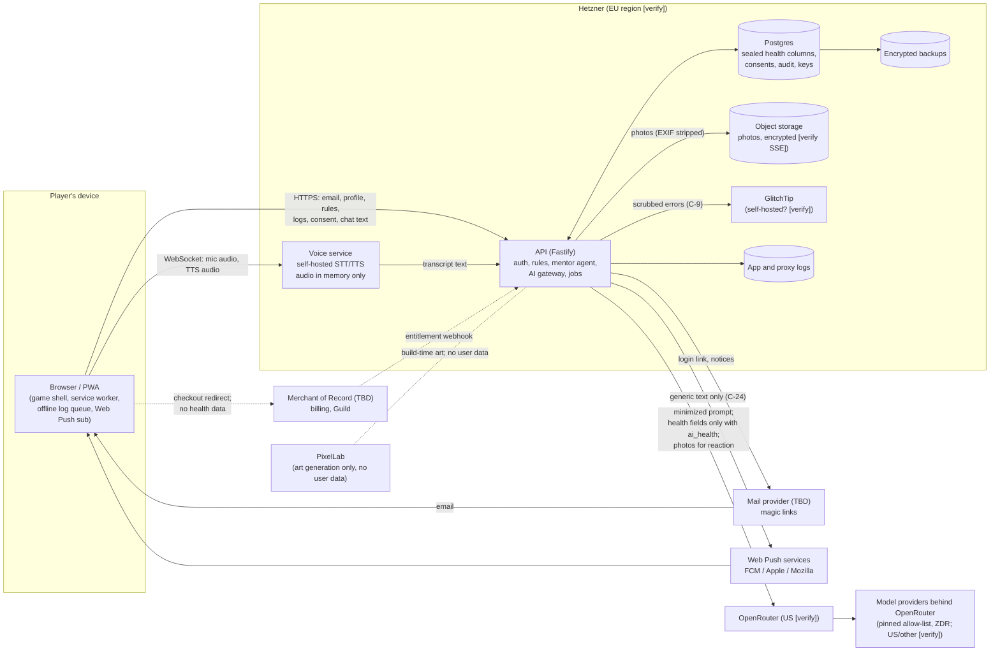

# Kitchen Quest: Personal Data Inventory

**Item:** C-33 (risk assessment and DPIA), first deliverable. Feeds the GDPR Art. 30 record of processing, the DPIA (`dpia.md`) and the risk register (`risk-register.md`).
**Date:** 2026-11-09. **Status:** started at M2; the owner of each later milestone adds that milestone's rows in the same PR as its schema.
**Sources:** `apps/api/src/db/schema.ts` and migrations `0000`–`0011` (built; §6 indexes every column, checked by `apps/api/test/inventory.test.ts`); some M2 rows still read "planned M2" where only part is built; spec §4, §5, §7, §9, §16–§20; `plans/m1-core`, `plans/m2-api`; compliance report §2–§6 (C-ids).
**Caveat:** only M1 and M2 have plan files. Rows for M3 onwards come from the spec and the C-id table, so column names are proposed, not final. This is not legal advice; **[verify]** marks facts to confirm and **[lawyer]** marks questions for counsel.

## 1. How to read this

**Category:** `identifier`, `health`, `location`, `child`, `usage`, `technical`. Health includes anything that reveals or infers a condition, a disability or a religious diet (GDPR Art. 9 covers both health and religion).

**Basis / consent purpose.** The C-1 purposes are `health_data`, `ai_health`, `voice`, `pantry_location`, `research`. Where no purpose applies, the working basis is shown: **contract** (GDPR Art. 6(1)(b), service the player asked for), **legit.** (Art. 6(1)(f), security and abuse prevention), **legal** (tax, breach duties). For US state health laws the "necessary to provide the requested service" exception may cover some collection **[lawyer: how far]**, so the plan is to take `health_data` consent for all of it.

**Sealed.** `S-U` = AES-256-GCM at the application layer under the per-user data key, with AAD = header + table + user id + row id (C-2/C-3/C-4). `S-1` = today's single `DATA_KEY` sealing (`apps/api/src/crypto/seal.ts`). `hash` = only a hash is stored. `no` = plaintext in a column or file.

**Export / delete.** "E" = in `GET /me/export` (C-7). "D" = removed by `DELETE /me` (C-8), counting crypto-shredding for backups (C-4). Where either is not yet covered it says so.

**Status:** `built`, `planned M-n` (a milestone plan or spec section commits to it), `proposed` (this inventory proposes it; not in any plan yet).

## 2. Data-flow diagram

Trust boundaries: device to API, API to every third party. Everything left of OpenRouter, mail, push, the Merchant of Record and PixelLab is under our control. The edges into those four are where C-13/C-14, C-24 and C-34 apply.

## 3. Inventory

### 3.1 Account and authentication

| ID | Element | Where | Category | Basis / purpose | Sealed | Retention | Processors | E / D | Status |
|---|---|---|---|---|---|---|---|---|---|
| A-1 | Email address | `users.email` (citext, unique) | identifier | contract | no (needed for lookup) | life of account | Hetzner; mail provider | E, D | built |
| A-2 | Email address of sign-in attempts, including people who never become users | `login_tokens.email` (no FK to `users`) | identifier | contract / legit. | no | 24 h after expiry or use (C-6) | Hetzner | not in E; **D only via C-8 (delete by email)** | built; retention planned M2 |
| A-3 | Login token | `login_tokens.token_hash` | technical | legit. (security) | hash | as A-2 | Hetzner | no / D via A-2 | built |
| A-4 | Age confirmation timestamp ("I'm 16+") | `users.age_confirmed_at` | identifier (age attestation) | contract; COPPA/age gate **[lawyer]** | no | life of account | Hetzner | E, D | built; C-39 may change the screen but keeps only this column |
| A-5 | Account creation time | `users.created_at` | usage | contract | no | life of account | Hetzner | E, D | built |
| A-6 | Session token | `sessions.token_hash`, `user_id`, `expires_at`, `created_at` | technical | contract / legit. | hash | delete at expiry (30 d) (C-6) | Hetzner | D | built; retention planned M2 |
| A-7 | Session cookie | browser cookie (`HttpOnly; Secure; SameSite=Lax`) | technical | contract | n/a | 30 d | none | n/a | built |
| A-8 | IP address (IPv4, or IPv6 cut to its /64) in the sign-in rate limiter | API process memory only (`SlidingWindowLimiter` in `apps/api/src/auth/rate-limit.ts`): never written to disk, the database or a log; lost on restart; per instance | identifier (IP) / technical | legit. (abuse, security) | no | each hit is dropped when it leaves the 1 h window; a key with no hits left goes at the next sweep (every minute, on a timer), so **at most 1 h 1 min after the last request** (N-2) | Hetzner (host memory) | not in E (not linked to an account); D by expiry | built (N-2). IPs and user agents in the reverse-proxy log: L-3 |
| A-12 | Email address in the per-email sign-in rate limiter | API process memory only, keyed by the lowercased address, as A-8 | identifier | legit. (abuse) | no | as A-8: at most 1 h 1 min after the last request | Hetzner (host memory) | not in E; D by expiry (an account delete does not wait for it: the entry holds no account link) | built (N-2) |
| A-13 | User id in the account-export limiter (5 exports per hour) | API process memory only, keyed by `users.id`, as A-8 | identifier (pseudonymous) | legit. (abuse; an export decrypts every rule) | no | as A-8: at most 1 h 1 min after the last export | Hetzner (host memory) | not in E; D by expiry | built (Step 7; N-2) |
| A-14 | IP address (as A-8) in the ingredient-search limiter (120 searches a minute; the search needs no sign-in) | API process memory only, keyed as A-8 | identifier (IP) / technical | legit. (abuse) | no | each hit leaves the 1 min window; the key goes at the next sweep, so **at most 2 min after the last search** | Hetzner (host memory) | not in E; D by expiry | built (M-5) |
| A-15 | User id in the recipe-read limiter (120 list or detail requests a minute; each decrypts every rule) | API process memory only, keyed by `users.id`, as A-8 | identifier (pseudonymous) | legit. (abuse) | no | as A-14: at most 2 min after the last request | Hetzner (host memory) | not in E; D by expiry | built (M-5) |
| A-9 | Session list / device label for "sign out everywhere" | `sessions` (extend) | technical | legit. | no | with A-6 | Hetzner | E, D | planned M2 (C-10b, optional) |
| A-10 | Email as held by the mail provider (recipient, delivery logs, suppression list) | mail provider (TBD) | identifier | contract | provider-side | target <= 30 d, set at the provider (`mail-provider.md`) | mail provider | D: processor-deletion queue (C-8) | planned M2/M12 (provider not chosen); settings required in `mail-provider.md` (N-1) |
| A-11 | Magic-link token inside the email body | mail provider copy of the message | technical (credential) | contract | hash at rest in our DB only | provider-side; the link is dead after 15 min or one use | mail provider | n/a | built (`SmtpMailer`): one `text/plain` part, no HTML, exactly one URL and no health content, tested (`test/mailer.test.ts`, `test/auth.test.ts`); provider-side tracking and rewriting off per `mail-provider.md` (N-1) |

### 3.2 Profile and settings

| ID | Element | Where | Category | Basis / purpose | Sealed | Retention | Processors | E / D | Status |
|---|---|---|---|---|---|---|---|---|---|
| P-1 | Country, region | `profiles.country`, `profiles.region` | location (coarse) | contract; used for seasonality and region gating (C-44) | no | life of account | Hetzner | E, D | built |
| P-2 | Market days, meals per week | `profiles.market_days`, `profiles.meals_per_week` | usage | contract | no | life of account | Hetzner | E, D | built |
| P-3 | Meal windows (name, start, end) | `profiles.meal_windows` (jsonb) | usage. The name is one of `breakfast`, `lunch`, `dinner`, `snack`, `other` (N-7), so it cannot spell out a fast or a condition; a name stored before N-7 reads back and exports as `other`; times alone could still hint at a fast | contract; **[lawyer]** whether `health_data` | no | life of account | Hetzner | E, D | built. N-7 ruling: names are a fixed set, not free text (Step 9) |
| P-4 | Reminder times, push preferences | `profiles` or `reminders` | usage | contract | no | life of account | Hetzner | E, D | planned M9 |
| P-5 | Voice accessibility flag (`accessibility_voice`) | `profiles` column or sealed row | health (implies disability) | `health_data` (C-19) | **S-U required** | life of account | Hetzner | E, D | planned M2 (if added in Step 4) / M7; **not in the current schema** |
| P-6 | Calorie display toggle and other UI settings | `profiles` (extend) | usage | contract | no | life of account | Hetzner | E, D | proposed. Hidden calorie toggle could imply a disordered-eating history; keep it out of AI prompts and analytics |
| P-7 | Notice acknowledgements (policy version seen) | `consents` | usage | legal | no | with consent rows | Hetzner | E, D (pseudonymized if kept, see J-1) | planned M2 |

### 3.3 Health data (the core)

| ID | Element | Where | Category | Basis / purpose | Sealed | Retention | Processors | E / D | Status |
|---|---|---|---|---|---|---|---|---|---|
| H-1 | Allergy and diet rules: target ids, type, severity, limit, phase, journey id | `rules.sealed` (blob; row id = rule id) | health (allergies, intolerances); religious diets are Art. 9 religion | `health_data` | **S-1 today**; S-U with AAD when Step 2c lands (C-3/C-4) | until user deletes the rule or account | Hetzner (ciphertext only) | E (decrypted), D | built. At most **200 rules per player** (M-5): one more is 400 `too_many_rules`; editing and deleting still work at the cap |
| H-2 | Rule free-text `note` ("the user's own words"), and the short free strings `limit.unit` and `phase.journeyId` | inside `rules.sealed` | health or any special category (religion, disability, third-party facts) | `health_data` | as H-1 | as H-1 | as H-1 | E, D | built. Capped (N-7): `note` 500, `limit.unit` 32, `phase.journeyId` 64 characters (§3.13) |
| H-3 | Rule metadata: owner, created and updated time, write version | `rules.user_id`, `created_at`, `updated_at`, `rules.version` (a counter, +1 per update; `PUT /rules/:id` with `If-Match` writes only over the version read, M4 final N4) | usage (reveals that the user has at least one rule and when it changed) | `health_data` | no | as H-1 | Hetzner | E, D | built. Row count is itself weakly sensitive |
| H-4 | Ingredient and category targets resolved by AI during rule expansion | AI request (only the typed term); result saved in H-1 | health | `ai_health` | n/a in transit; then H-1 | not retained by us; provider ZDR | OpenRouter, model provider | covered via H-1 | planned M8 (C-22) |
| H-5 | Diet journeys and enrollments (e.g. low-FODMAP, custom journeys: name, phases, rule sets) | `journeys`, `journey_enrollments` | health (journey implies condition) | `health_data` | S-U (C-23) | until deleted | Hetzner | E, D | planned M9 |
| H-6 | Symptom check-ins: symptom names, 0 to 3 scores, free-text note, date | `symptom_checkins` | health | `health_data` | S-U (C-23); date may stay plain | until deleted | Hetzner | E, D | planned M9 |
| H-7 | Meal logs: dish (canon slug and servings eaten) or free-form description, the date eaten and the slot | `meal_logs` (`meal_logs.sealed` is core's `MealItem`, sealed S-U with AAD `{ table: 'meal_logs', userId, rowId }`; `meal_logs.id`, `meal_logs.user_id`, `meal_logs.eaten_on`, `meal_logs.slot`, `meal_logs.created_at` plain) | health (nutrition; infers conditions) | `health_data` (403 `consent_required` without it; `confirmed: true` on every write) | S-U (C-23); date and slot stay plain (needed for range reads and the mentor's "already logged" context) | until the player deletes the log, withdraws `health_data` with "delete" (`HEALTH_TABLES`), or deletes the account | Hetzner (ciphertext only) | E (decrypted), D | **built M4** (Step 5), minimal: no nutrition numbers or estimates yet (M9). Logged dates must be within 7 days before and 1 day after today; free description capped (§3.13). **Abuse limit** (ruling M-4): at most 200 logs per player per rolling day, identical for every plan and never a paid feature (`usage/write-cap.ts`; 429 with `write.daily_limit`) |
| H-8 | Nutrition snapshots and weekly aggregates | `nutrition_snapshots` or computed | health (derived) | `health_data` | S-U if stored (derived data is still health data) | rebuild on demand preferred; else as H-7 | Hetzner | E, D | planned M5/M9 |
| H-9 | Low-intake check-in | **computed on the fly, never stored as a label** (C-27) | health inference | `health_data` | n/a | none | none | n/a | planned M9; control is the absence of data |
| H-10 | Body metrics (weight etc.) | not designed | health | `health_data` + separate opt-in | S-U | n/a | n/a | n/a | out of v1 (spec §5); listed so nobody adds it without a DPIA update |
| H-11 | Pantry items, market list, meal plan, plan items | `pantry_items` (`pantry_items.sealed` is core's `PantryItem`, name and ingredient id, sealed S-U with AAD `{ table: 'pantry_items', userId, rowId }`; `pantry_items.id`, `pantry_items.user_id`, `pantry_items.created_at` plain); later `meal_plans`, `plan_items`, `market_runs` | usage; pantry contents can imply diet or condition (gluten-free staples) | contract; **[lawyer]** whether `health_data`. No consent is asked today; every change needs `confirmed: true` | S-U for the pantry (built); proposed for the plan | until the player removes the item or deletes the account; a `health_data` withdrawal keeps it (not in `HEALTH_TABLES`) | Hetzner (ciphertext only) | E (decrypted), D | `pantry_items` **built M4** (Step 5), at most **300 items per player** (one more is 400 `too_many_items`); plan and market tables planned M5/M9 |
| H-12 | Margin Notes (own recipe variations) and private recipes (Cooklang) | `recipe_notes`, `private_recipes` | usage; free text can contain health facts | contract; `health_data` if free text can hold health content | proposed S-U | until deleted | Hetzner | E (also `.cook` files), D | planned M5 |
| H-13 | "Cooked for Someone" record (who the player fed) | `shared_table` | usage; **data about third parties** | contract | proposed S-U | until deleted | Hetzner | E, D | planned M5. Proposed rule: store a label the player types, never a contact, and never a health fact about the other person (see R-19) |
| H-14 | Household Kitchen membership and sharing opt-ins | `households`, `household_members` | usage; sharing flags can reveal a member's rules | `health_data` per member (C-25) | per-member S-U | until member leaves or deletes | Hetzner | E (own data only), D | planned M9 |
| H-15 | Clinician share artefact (expiring link or PDF) | `shares` (token hash, expiry, scope) and the generated report | health | `health_data` and the player's own action | token as hash; report content generated on demand, not stored if possible | 7 d default, revocable (C-26) | Hetzner | E (share log), D | planned M9 or later |

### 3.4 AI requests and conversations

| ID | Element | Where | Category | Basis / purpose | Sealed | Retention | Processors | E / D | Status |
|---|---|---|---|---|---|---|---|---|---|
| I-1 | Mentor and NPC conversation transcripts (text and voice transcripts) | `conversations` (content-free: `conversations.id`, `conversations.user_id`, `conversations.started_at`, `conversations.last_turn_at`, `conversations.turn_seq`, `conversations.last_turn_key`: the last turn's client-made random UUID, content-free, so a retried turn is processed once, M4 final J2) and `messages` (`messages.sealed` is the mentor's `StoredMessage`, the player's text or the Pan's reply parts and proposal ids, sealed S-U with AAD `{ table: 'messages', userId, rowId }`; `messages.id`, `messages.conversation_id`, `messages.user_id`, `messages.seq`, `messages.role`, `messages.created_at` plain). Without `health_data` the history is held in API memory only (`MemoryHistory`: at most 8 messages, 30 minutes after the last, never on disk) and no `messages` row is written | health (free text reveals allergies, symptoms, meals); possibly religion and third parties | `health_data` (notice v2 names it; without it nothing is stored); `ai_health` for the AI leg | S-U (C-12) | `messages` **30 days** after written, `conversations` 30 days after the last turn (C-6 job); user-clearable ("forget this conversation", which hard-deletes the conversation, its messages and its proposals); a `health_data` withdrawal with "delete" removes `messages` (`HEALTH_TABLES`; the content-free `conversations` stay, P-14) | Hetzner (ciphertext only) | E (decrypted), D | **built M4** (Step 6; the turn and forget routes, Step 7) |
| I-2 | The AI request body: persona, style guide, compact player context, tool definitions, user turn | HTTPS to OpenRouter, then the model provider. **Not stored by us** (C-15) | health when it carries rules, severities, symptoms, journey phase or meal text; otherwise usage | `ai_health` for health fields; contract for the rest | TLS in transit; no prompt logging | provider ZDR required (C-14); we keep none | OpenRouter, model providers | n/a (not stored by us); processor list in E | **built M4** (Steps 4, 7): `buildRequestBody` pins `data_collection: "deny"`, `zdr: true` and the provider allow-list; health turns reach the model only with `ai_health`; the model is offered `propose_*` tools only and its text is never shown or stored (R9). Production refuses AI until the DPA is signed (P-11) |
| I-3 | Prompt context for non-consenting users | same | usage only | contract | n/a | n/a | OpenRouter | n/a | **built M4** (Step 7, C-13): without `ai_health` health turns never reach the model, and other turns carry no rules, meals, pantry or health history (`minimiseHistory`); tests assert no rule names or ids in the prompt |
| I-4 | AI response, tool calls and proposed writes | the response in memory only (C-15); each proposal card the server shows is a `mentor_proposals` row (`mentor_proposals.sealed` is core's `ProposalCard`, sealed S-U with AAD `{ table: 'mentor_proposals', userId, rowId }`; `mentor_proposals.undo_sealed` the confirmed write's undo payload under `{ table: 'mentor_proposals.undo', userId, rowId }`; `mentor_proposals.id`, `mentor_proposals.user_id`, `mentor_proposals.conversation_id`, `mentor_proposals.turn_seq`, `mentor_proposals.kind`, `mentor_proposals.severe`, `mentor_proposals.status`, `mentor_proposals.write_ref`, `mentor_proposals.channel`, `mentor_proposals.created_at`, `mentor_proposals.expires_at`, `mentor_proposals.decided_at` plain); confirmed writes land in H-1, H-7, H-11 or the profile | health (a rule or meal card) | as I-2; the stored card needs no extra consent, the write it guards does | S-U | open for 30 minutes (`PROPOSAL_TTL_MS`). An **undecided** card (open or expired) is deleted as soon as `expires_at` passes (C-6 job, at most an hour late; the user's next card also purges their expired ones). A **decided** card (confirmed, rejected, undone) is kept **24 hours** after it was made, for the 5-minute undo window (`UNDO_WINDOW_MS`) and the audit trail, then deleted. Also deleted on forget, on a `health_data` withdrawal with "delete" (`HEALTH_TABLES`) and with the account. **[lawyer]** a rule or meal card is held, sealed, for up to 30 minutes for a player who has not granted `health_data` (the card is how they are asked; nothing is written until they consent and tap) | Hetzner (ciphertext only); OpenRouter for the response | E (card decrypted, with status; not the undo payload), D | **built M4** (Step 6); Step 8's guard reads it |
| I-5 | Recipe ingestion input: pasted text, caption, screenshot, URL | AI request; fetched page | usage (may carry personal notes) | contract | n/a; not stored beyond the draft | draft until confirmed or discarded | OpenRouter; fetched site (receives our server IP only, C-21) | E (resulting recipe), D | planned M8 |
| I-6 | NPC Q&A turns | as I-1 | health when grounded with rules | `ai_health` | S-U | as I-1 | OpenRouter | E, D | planned M8 |
| I-7 | Failed-request queue (retry queue for AI calls): **no server queue (N-4)** | **none on the server** (M4 Ruling 9, pre-flight C23): the game retries a failed turn once, in browser memory only, then offers "Try again"; nothing is queued or stored by the API | health (the unsent message) | as I-2 | n/a (nothing stored) | until the retry or the page closes | none | n/a | **built M4** (Step 10): no server-side queue (N-4). A later queue must be sealed or hold no content (R-14) |
| I-8 | Evaluation sets | repo `evals/` | none if synthetic | n/a | n/a | n/a | none | n/a | planned M8 (C-15: synthetic or contributor-consented only) |

### 3.5 Voice

| ID | Element | Where | Category | Basis / purpose | Sealed | Retention | Processors | E / D | Status |
|---|---|---|---|---|---|---|---|---|---|
| V-1 | Microphone audio stream | browser to voice service over TLS; **memory only** | identifier-adjacent (voice) and health content; biometric only if voiceprints were derived, which P-7 bans | `voice` | n/a | none (test greps FS and logs, C-18) | Hetzner (voice host; GPU host if different, DPA) | n/a | planned M7 |
| V-2 | Partial and final STT transcripts | in memory, then I-1 | as I-1 | `voice` + `health_data` | S-U once stored | as I-1; partials never logged | Hetzner | E, D | planned M7 |
| V-3 | TTS output audio | generated per turn, streamed, not stored | technical | contract | n/a | none | Hetzner | n/a | planned M7 |
| V-4 | Voice session metadata (duration, units for allowance) | `usage_events` (feature `voice`) | usage | contract | no | 13 months | Hetzner | E (totals), D | built (table); planned M7 (writes) |

### 3.6 Photos

| ID | Element | Where | Category | Basis / purpose | Sealed | Retention | Processors | E / D | Status |
|---|---|---|---|---|---|---|---|---|---|
| F-1 | Food photos (Recipe Book, cook session) | Hetzner Object Storage, random object keys; row in `photos` (owner, key, recipe ref) | health when it shows what the player ate; can show faces, kitchens, and with EXIF, location | `health_data` | S-U client-sealed or app-sealed before upload (C-20; SSE support **[verify]**) | until user deletes (Recipe Book) | Hetzner | E (files), D via processor-deletion queue | planned M8 |
| F-2 | EXIF, GPS and device metadata | stripped before storage and before any AI call (C-20) | location, technical | none (not kept) | n/a | none | none | n/a | planned M8; test required |
| F-3 | Photo sent to AI for the cook's reaction | AI request | health | `ai_health` | TLS | provider ZDR | OpenRouter, model provider | n/a | planned M8 |
| F-4 | Face check on upload (family mode) | on device only | child / biometric question | pending counsel | n/a | stores and sends nothing | none | n/a | planned M13 (C-45) **[lawyer]** |

### 3.7 Neighborhood Pantry (location and other people)

| ID | Element | Where | Category | Basis / purpose | Sealed | Retention | Processors | E / D | Status |
|---|---|---|---|---|---|---|---|---|---|
| N-1 | Post: item, portions, made-on and keeps-until, pickup window | `pantry_posts` | usage; reveals diet | `pantry_location` | no (shown to neighbours by design) | deleted after pickup window (C-6, C-28) | Hetzner | E, D | planned M11 |
| N-2 | Approximate area (1 km grid cell, snapped on device) | `pantry_posts.cell` | location | `pantry_location` | no | as N-1 | Hetzner | E, D | planned M11 (C-28) |
| N-3 | Exact pickup spot, shared after acceptance | `pantry_handoffs` | location (precise) | `pantry_location` | S-U, visible only to the two parties | deleted at end of window | Hetzner | E, D | planned M11 |
| N-4 | Allergen tags and ingredient list on a post | `pantry_posts` | health-adjacent (of the poster's dish, not of the poster) | `pantry_location` | no | as N-1 | Hetzner | E, D | planned M11 |
| N-5 | Display handle or first name for requests | `profiles` (extend) or `pantry_handles` | identifier | `pantry_location` | no | life of account | Hetzner | E, D | planned M11; **new identifier not yet in a plan** |
| N-6 | Requests, messages between neighbours | `pantry_requests` | identifier, usage | `pantry_location` | proposed S-U | deleted with the post | Hetzner | E, D | planned M11; no free-text contact details (spec §18) |
| N-7 | Reports and blocks | `pantry_reports`, `pantry_blocks` | usage; reporter identity hidden from reported user | legit. (safety) | no | 12 months (C-29) | Hetzner | E (the user's own reports), D | planned M11 |
| N-8 | Requester's own status (OK, blocked, unverified) per post | computed on the requester's device | health | n/a (on device) | n/a | none | none | n/a | planned M11 (C-28) |
| N-9 | Static map of community fridges and food banks | public data in repo | none | n/a | n/a | n/a | none | n/a | planned M11. Viewing is not logged per user |

### 3.8 Children (Family Mode, M13)

No child data is collected until counsel signs off (P-9). The rows are reserved so the M5 schema and consent ledger are built for them.

| ID | Element | Where | Category | Basis / purpose | Sealed | Retention | Processors | E / D | Status |
|---|---|---|---|---|---|---|---|---|---|
| K-1 | Child profile: nickname, age band, preset avatar | `child_profiles` | child, identifier | parental explicit consent per child, via `consents(subject_kind='child_profile')` (C-45) | S-U with a per-child key | until deleted (two taps) | Hetzner | E (parent export), D | planned M5 (reserve) / M13 |
| K-2 | Child allergy rules (parent entered) | `child_rules` | child, health | parental explicit consent | sealed with per-child key (C-45) | until deleted | Hetzner | E, D (key shred) | planned M13 |
| K-3 | Child skill progress, cooked-together records | `child_progress` | child, usage | parental consent | proposed S-U | until deleted | Hetzner | E, D | planned M13 |
| K-4 | Parental consent record per child | `consents` (subject fields) | child, legal | legal | no | life of profile plus audit period **[lawyer]** | Hetzner | E, D | planned M5 / M13 |
| K-5 | Never stored: child intake or nutrition, photos of children, voice, location, birthdays | none | child | n/a | n/a | n/a | n/a | n/a | rule (spec §19, P-9) |

### 3.9 Usage, billing, entitlements

| ID | Element | Where | Category | Basis / purpose | Sealed | Retention | Processors | E / D | Status |
|---|---|---|---|---|---|---|---|---|---|
| U-1 | AI and voice usage events: feature, units, cost, time | `usage_events` | usage (content-free) | contract (allowances) | no | 13 months (C-6) | Hetzner | E (per-feature totals), D | built; retention planned M2. M4 Step 12: a zero-unit `mentor_text` row is written **before** each model call is sent and completed with units and cost on success, so the export can list OpenRouter as a recipient (`inUse`, `sentFrom`/`sentUntil`) even for a call that failed. **[lawyer]** after 13 months the rows are deleted, so a past disclosure older than that is no longer shown in the export's recipients (GDPR Art. 15(1)(c) "have been disclosed"): is a 13-month look-back enough, or should a content-free "ever sent" marker be kept for the account's life? |
| U-7 | The AI's total spend per hour across all players (no user id, no content), for the global daily budget | `ai_cost_hours` (`ai_cost_hours.hour`, `ai_cost_hours.cost_microusd`) | none (aggregate, not personal data) | legit. (cost control) | no | 48 hours (C-6 retention job) | Hetzner | n/a (no subject) | built (M4 Step 7) |
| U-2 | Entitlements: kind, source, start and end | `entitlements` | usage; kind `bursary` or `founding` hints at financial circumstances | contract | no | life of account | Hetzner | E, D | built. See R-18 |
| U-3 | Billing identity (name, card, address, tax) | at the Merchant of Record only; we store nothing (schema comment: "never holds price, payment or card data") | identifier, financial | contract; legal | provider-side | provider legal retention **[verify]** | Merchant of Record (TBD) | processor list in E; D partly retained by law | planned M12 |
| U-4 | Merchant of Record customer id / subscription id | `entitlements.source` or `billing_links` | identifier | contract | no | life of account | Hetzner, Merchant of Record | E, D | proposed |
| U-5 | Progress (M5, Ruling 7): the content-free facts of play (a recipe read through, a drill, a dish or Pantry Frame cooked, a quest step or quest done, a technique recognized, a market run closed, a meal logged (the local minute and the meal log's random id only, no meal content), an M3 toolkit record imported), and what each earned (XP, stamps, trust levels, levels, technique certificates), fixed when granted. Levels, trust, stamps and technique tiers and freshness are derived from these two ledgers, never stored | `progress_events` (`progress_events.id`, `progress_events.user_id`, `progress_events.seq` (insertion order), `progress_events.client_id` (the game's event id: **a UUID, enforced** (any other id rejects the event), so no client-chosen text is stored), `progress_events.kind`, `progress_events.at` (the player's local date, 2026-01-01 to today + 1), `progress_events.body` (the rest of core's `ProgressEvent`: canon slugs, quest, technique, frame and cook ids, step numbers, a minute, a week start; strict shape, every id checked against the catalogue, so no free text), `progress_events.meal_log_id` (a `meal_logged` event's meal log, that kind only, one event per log; a foreign key to `meal_logs` **on delete cascade**), `progress_events.created_at`); `reward_grants` (`reward_grants.id`, `reward_grants.user_id`, `reward_grants.event_id` (the event row it was granted for: a plain column, **not** a foreign key, so erasing a meal-log event keeps its grants), `reward_grants.kind`, `reward_grants.body` (core's self-contained `RewardGrant`: its own id, the event's client id (a UUID), the day (`isoDay`), and the amount, stamp, cook and level or technique; never the meal log id, no event content). **No time column**: a grant's only date is its day) | usage; the dish slugs reveal what the player cooked, and `meal_logged` when they ate (**[lawyer]** whether either needs `health_data` as a basis; today `meal_logged` events are accepted only while `health_data` is granted, the gate of `POST /meals`, and the rest is contract, like the pantry) | contract (progression, spec §6); `meal_logged` only with `health_data` | no (plain; content-free ids and numbers) | life of account. Grants are append-only: no update or delete path, only account delete. A meal-log undo (`DELETE /meals/:id`) erases that log's `meal_logged` event in the same transaction (the foreign key cascades), and a `health_data` withdraw-with-delete erases every `meal_logged` event: no row or content kept. Their grants are kept, so XP, level and stamps never drop (spec §6, I2 ruling), and a kept grant holds kind, amount and day only. **[lawyer]** confirm that keeping those grants (kind, amount, day) after a `health_data` delete is acceptable; the content-free `progress.record` and `meals.create` audit rows (J-4) also keep the time of the post for 24 months | Hetzner | E (`progress.events`, `progress.grants` (with `isoDay`), `progress.view`), D (cascade on account delete; both ledgers) | **built M5** (Step 5). `POST /progress/events` takes at most 100 events a request, at most 60 progress requests a minute per player, and at most 200 recorded posts a rolling day (the M4 write cap, the same for every player and plan; 429 `rate_limited` with `retryAfterSeconds`, which changes nothing already stored); core caps each local day at 200 events (per event, C14). Never read by entitlement code (never rule 3) |
| U-6 | Contributor share ledger | `contributor_payouts` | identifier, financial | contract | no | legal retention (tax) **[verify]** | payout provider (TBD) | E; D limited by law | proposed, M12+ |

### 3.10 Compliance metadata

| ID | Element | Where | Category | Basis / purpose | Sealed | Retention | Processors | E / D | Status |
|---|---|---|---|---|---|---|---|---|---|
| J-1 | Consent ledger: purpose, notice version, notice sha256, granted, withdrawn, why it ended, method (and later subject) | `consents` (`consents.purpose`, `consents.notice_version`, `consents.notice_sha256`, `consents.granted_at`, `consents.withdrawn_at`, `consents.ended_reason`, `consents.method`) | usage (legal evidence); the existence of a `health_data` consent is itself weakly sensitive | legal (proof of consent) | no | life of account (cascade on delete) **[lawyer]** whether to keep pseudonymized | Hetzner | E (full history), D | built (C-1). The `health_data` notice is `notices/health_data-v2.md` (version `v2`, its SHA-256 in each grant); it names religious and cultural diets (N-7), the meals kept and the 30-day Pan conversations (C-12). The `ai_health` notice is `notices/ai_health-v1.md`. Grants under older versions no longer count |
| J-2 | Per-user wrapped data key | `user_keys(user_id, key_id, wrapped)` | technical | security | wrapped by the ring key | life of account; deletion = crypto-shred | Hetzner | not exported; D | planned M2 (C-4) |
| J-3 | Master key ring | environment (`DATA_KEYS`, `DATA_KEY_ID`), kept out of the repo and the DB backup (C-2) | technical (secret) | security | n/a | rotated yearly and at offboarding | Hetzner host | n/a | planned M2; **today a single `DATA_KEY` in env** |
| J-4 | Audit events: time, actor kind and id, subject, action, target, request id; never content | `audit_events` (append-only) | usage / technical | legit.; legal | no | 24 months; subject pseudonymized (HMAC) on account delete (C-5) | Hetzner | E (where subject), D = pseudonymize | planned M2 |
| J-5 | Retention-job run records | logs or `job_runs` | technical | legit. | no | 90 d proposed | Hetzner | n/a | planned M2 |
| J-6 | Data-rights request log | `audit_events` (action `dsr_*`) plus privacy mailbox | identifier | legal | no | 3 years **[lawyer]** | mail provider; Hetzner | E (own), partly retained | planned M12 (C-31) |
| J-7 | Processor register | `docs/compliance/processors.json` (repo) | none | legal | n/a | n/a | none | E (list, C-7) | built (in the export, Step 7) |
| J-8 | Self-read counters: how many times a day the player read their own rules (`GET /rules`, and `GET /recipes` and `GET /recipes/<slug>`, which decrypt the rules to check recipes (M-6), so the count is honest), meal logs (`GET /meals`, resource `meals`) pantry (`GET /pantry`, resource `pantry`) and progress (`GET /progress`, resource `progress`, M5) | `self_read_counts` (`self_read_counts.user_id`, `self_read_counts.resource`, `self_read_counts.day`, `self_read_counts.count`) | usage (content-free; stands in for per-read audit events so no "when they looked" log is built) | legit. (C-5 access accountability) | no | 24 months (C-6 retention job) | Hetzner | E, D (cascade) | built (Step 7) |

### 3.11 Logs, errors, client-side storage

| ID | Element | Where | Category | Basis / purpose | Sealed | Retention | Processors | E / D | Status |
|---|---|---|---|---|---|---|---|---|---|
| L-1 | API request log: method, route **pattern** (`/rules/:id`, `(unmatched)` for unknown paths), status, timing, request id. **No** query string, body, headers, cookies or client address (C-9) | stdout, shipped to host logs | technical | legit. | no | **14 days**, at most 30 (§3.14) | Hetzner | not in E (holds no identifier); D by expiry | built (`apps/api/src/logging/redact.ts`, tested with `captureLogs()`); retention set at the log host (N-2) |
| L-2 | Error reports (stack trace, route, request id; request data, breadcrumbs and email stripped) | GlitchTip | technical | legit. | n/a | **unset, proposed 30 d** | GlitchTip (self-hosted? **[verify]**) | not in E; D by expiry | planned M2 (`before_send`, C-9); 500-path logging already PII-free (commit 439f6d4) |
| L-3 | Reverse-proxy access log | Hetzner host / proxy | technical (IP, URL, user agent) | legit. | no | **14 days**, at most 30 (§3.14) | Hetzner | not in E; D by expiry | planned M12 (C-38); retention registered here (N-2) |
| L-4 | Database and object-storage backups | Hetzner / backup target | all of the above, ciphertext for health | legit. (availability) | health columns stay sealed; whole-backup encryption (C-35) | 30 days (C-35) | Hetzner | D via crypto-shred (C-4) | planned M12 |
| L-5 | Service-worker cache and IndexedDB: recipes, offline log queue, pending meal and symptom logs | browser storage on the player's device | health (queued logs) | `health_data` | **no** today in design; proposed WebCrypto or clear-on-sign-out | until sync, until sign-out | none | E (server copy once synced), D (device: "sign out" wipes) | planned M4/M9; **new: not in any C-id** (see R-12) |
| L-6 | Web Push subscription: endpoint URL, keys | `push_subscriptions` | technical, identifier (endpoint is a per-device id) | contract; consent via browser permission | no | until unsubscribe or account delete | Hetzner; FCM, Apple, Mozilla | E, D | planned M9 |
| L-7 | Push payloads | in transit to push service | none by rule: generic text only (C-24) | contract | RFC 8291 encryption | transient | push services | n/a | planned M9; test required |
| L-8 | localStorage / UI state | browser | usage | contract | no | until cleared | none | n/a | planned M4; keep health data out |

### 3.12 Content that names people

| ID | Element | Where | Category | Basis / purpose | Sealed | Retention | Processors | E / D | Status |
|---|---|---|---|---|---|---|---|---|---|
| W-1 | Recipe contributor ids (stable ids, e.g. GitHub handles) | `recipes/**/*.cook` front matter; `canon_recipes.contributors` (M2 Step 6) | identifier (public, third party) | legit.; contributor agreement | no | as long as the recipe is in the canon | GitHub; Hetzner | not in the player's E; contributor rights handled separately (**gap**) | planned M2 Step 6 |
| W-2 | Recipe source URL and author credit | `canon_recipes.source`, recipe cards | identifier (third party, public) | legit. (credit) | no | as above | Hetzner | n/a | built |
| W-3 | Canon recipe metadata | `canon_recipes` | none | n/a | n/a | n/a | n/a | n/a | built |

### 3.13 Free-text fields and their caps (N-7)

Every string the API accepts from a player, with its maximum. A field not listed here takes no free text. Enforced in the route's zod schema (anything longer is 400 `bad_request` naming the field) or, where a shape is required, by the shape check.

| Field | Where it is stored | Max | Notes |
|---|---|---|---|
| `email` (`POST /auth/request`) | `login_tokens.email`, then `users.email` | 254 | must be an email address |
| `token` (`POST /auth/verify`) | nowhere (hashed and compared) | 43 | must have the shape of an issued token; anything else is 401 like any bad link |
| `country`, `region` (`PUT /profile`) | `profiles.country`, `profiles.region` | 80 each | coarse location only |
| meal-window `name` (`PUT /profile`) | `profiles.meal_windows` | n/a | enum `breakfast`, `lunch`, `dinner`, `snack`, `other`; not free text |
| meal-window `start`, `end` | `profiles.meal_windows` | 5 | `HH:MM` |
| `rule.note` (`POST`/`PUT /rules`) | `rules.sealed` | 500 | sealed (S-U) |
| `rule.limit.unit` | `rules.sealed` | 32 | sealed; core requires a non-empty string |
| `rule.phase.journeyId` | `rules.sealed` | 64 | sealed |
| `rule.phase.start`, `rule.phase.end` | `rules.sealed` | 10 | core requires `YYYY-MM-DD` |
| `rule.target.ids[]` | `rules.sealed` | n/a | each must be an id in the ingredient graph (core) |
| rules per player (`POST /rules`) | `rules` | 200 rows | not a string cap: bounds how much health data one account holds and how much each request decrypts (M-5); 400 `too_many_rules` |
| meal `item.description` (`POST /meals`, free meal) | `meal_logs.sealed` | 200 after trim (core `MEAL_DESCRIPTION_MAX`) | sealed (S-U); at least 1 character after trim |
| meal `item.slug` (dish) | `meal_logs.sealed` | n/a | must be a `canon_recipes.slug` |
| meal `item.servings` (dish) | `meal_logs.sealed` | n/a | a finite number from 0.25 to 10 |
| meal `eatenOn`, `slot` | `meal_logs.eaten_on`, `meal_logs.slot` | 10 / n/a | a real `YYYY-MM-DD` within [today − 7, today + 1]; `slot` is the enum `breakfast`, `lunch`, `dinner`, `snack`, `other` |
| `from`, `to` (`GET /meals`) | nowhere | 10 each | real dates, `from` ≤ `to`, at most 31 days both included |
| pantry `add[].name` (`POST /pantry/changes`) | `pantry_items.sealed` | 80 after trim | sealed (S-U); at least 1 character after trim |
| pantry `add[].ingredientId` | `pantry_items.sealed` | 64 | null or an id in the ingredient graph |
| pantry `removeNames[]`, `removeIds[]` | nowhere (matched, then dropped) | 80 / 64 each, at most 300 entries | unmatched entries are ignored |
| pantry items per player (`POST /pantry/changes`) | `pantry_items` | 300 rows | not a string cap: bounds each request's decrypting (M-5); 400 `too_many_items`. Serialized per player by an advisory lock, so two racing adds cannot pass it |
| progress event `id` (`POST /progress/events`) | `progress_events.client_id`, `reward_grants.body` (`eventId`) | 36 | must be a UUID (stored in lower case), so it is never free text; any other id rejects the event `bad_event` and is not echoed |
| progress event `mealLogId` (`meal_logged`) | `progress_events.meal_log_id` | 36 | a UUID naming one of the player's own meal logs eaten on the event's date, with `health_data` granted; else rejected (`unknown_meal_log`, `consent_required`) |
| progress event ids and refs (`recipe`, `quest`, `technique`, `frame`, `standsInFor[]`, `recipes[]`) | `progress_events.body` | 200 each; at most 20 `standsInFor`, 100 `recipes` | not free text: each must be a canon slug, quest, technique, frame or cook id the catalogue knows, or the event is rejected and nothing is stored |
| progress events per request / per day (`POST /progress/events`) | `progress_events` | 100 a request (more is 400); 200 a local day; dates 2026-01-01 to today + 1 | not a string cap. The daily cap is core's, per event (C14): the event over it is rejected `too_many_events`, the rest are recorded. Requests: 60 a minute and 200 recorded posts a rolling day per player (429) |
| `q` (`GET /ingredients/search`) | nowhere; never logged | 100 | |
| `date` (`GET /recipes`) | nowhere | 10 | `YYYY-MM-DD` within a day of today |
| `noticeVersion` (`POST /me/consents`) | `consents.notice_version` | 64 | must equal the current notice's version |
| `confirm` (`DELETE /me`) | nowhere | n/a | must equal `delete my account` |

### 3.14 Logs and rate-limit state: retention (N-2, registered with C-6)

- **Rate-limit state** is in API process memory only: the sign-in limiters keyed by IP (or IPv6 /64, A-8) and by lowercased email (A-12), the export limiter keyed by user id (A-13), the ingredient-search limiter keyed by IP (A-14) and the recipe-read limiter keyed by user id (A-15). It is never written to disk, the database or a log, and a restart clears it. Each key is dropped at most one minute after its last hit leaves its window (`sweepPeriodically`, tested in `apps/api/test/rate-limit.test.ts`), so no address, email or id is held more than 1 h 1 min after the last request (2 min for the one-minute limiters, A-14 and A-15). With several API instances each holds its own state.
- **Mentor history and flags** (I-1) are in API process memory only: the history of a player without `health_data` consent (`MemoryHistory`, keyed by user and conversation id, at most 8 messages, dropped 30 minutes after the last) and the conversations where a child spoke (`MemoryFlags`, Step 7). Never written to disk, the database or a log; a restart clears them; `sweep` drops expired keys.
- **API request log (L-1)** holds route patterns only (C-9), so it carries no identifier. Keep it **14 days** at the log host; 30 days is the ceiling. It is not in the export, because nothing in it links to a player.
- **Reverse-proxy access log (L-3)** holds IPs, full URLs and user agents. Keep it **14 days**, at most 30. Configure the proxy (M12, C-38) to log the path without the query string, and not to log request bodies or cookies. It is not in the export; a data-rights request is answered by expiry.
- **Error reports (L-2):** proposed **30 days** at GlitchTip, set when it is deployed (M2/M12).
- **`TRUST_PROXY`:** the search, export and mentor turn limiters key on `req.ip`, so `TRUST_PROXY` must name the reverse proxy in deploy (hop count or its addresses); otherwise every player shares the proxy's address.
- The privacy notice (C-30, M12) states these periods. Any new log, proxy or limiter store adds a row here in the same PR.

## 4. Observations that drive the risk register

1. **Built today, sealed with one env key:** only `rules.sealed`. Everything else built is account, profile, usage or entitlement data. No consent record, no audit trail, and no key ring exist yet, so today's health data is one DB-and-key compromise from exposure (R-04).
2. **Plain columns that deserve a second look:** `profiles.meal_windows` (names are now a fixed set, N-7, and older free-text names read as `other`; the times alone could still hint at a fast), the future `profiles.accessibility_voice`, `entitlements.kind` (bursary), row counts and timestamps of sealed tables.
3. **Three places health data can leave without a sealed column:** logs and error reports (C-9), the AI request (C-13/C-14), and the offline browser store (new, L-5).
4. **Data that is not about the user:** neighbours' handles and pick-up spots (M11), people fed ("Cooked for Someone"), children (M13), recipe contributors (W-1), and non-users who typed someone else's email (A-2).
5. **Gaps with no C-id today:** log and access-log retention (L-1, L-3, A-8); inactive-account retention; the AI retry queue (I-7); the offline browser store (L-5); contributor ids (W-1); mail-provider handling of login links (A-11); and a check that this inventory stays in step with the schema. See the final section of `risk-register.md`.

## 5. Keeping this file true

- Every PR that adds or changes a table, column, object-storage path, outbound request or log field updates this file in the same PR.
- `apps/api/test/inventory.test.ts` (N-8) migrates a fresh database, lists every `table.column` from `information_schema`, and fails if one is missing from its table's row in §6 (only §6 is read). Add a new column to the row that covers it and to §6.
- Review annually and on any new processor (P-11), new AI feature, new region or any change to a consent purpose.

## 6. Column index (N-8)

Every column the migrations create, as `table.column`, with the inventory row that covers it. `apps/api/test/inventory.test.ts` reads only this table and fails if a column is missing from its table's row.

| Table | Columns | Rows |
|---|---|---|
| `users` | `users.id`, `users.email`, `users.age_confirmed_at`, `users.created_at` | A-1, A-4, A-5 (`users.id` is the internal account id; A-13 keys on it) |
| `login_tokens` | `login_tokens.id`, `login_tokens.email`, `login_tokens.token_hash`, `login_tokens.expires_at`, `login_tokens.used_at`, `login_tokens.created_at` | A-2, A-3 |
| `sessions` | `sessions.id`, `sessions.user_id`, `sessions.token_hash`, `sessions.expires_at`, `sessions.created_at` | A-6 |
| `profiles` | `profiles.user_id`, `profiles.market_days`, `profiles.meals_per_week`, `profiles.country`, `profiles.region`, `profiles.meal_windows`, `profiles.updated_at` | P-1, P-2, P-3 |
| `rules` | `rules.id`, `rules.user_id`, `rules.sealed`, `rules.created_at`, `rules.updated_at`, `rules.version` | H-1, H-2, H-3 |
| `meal_logs` | `meal_logs.id`, `meal_logs.user_id`, `meal_logs.eaten_on`, `meal_logs.slot`, `meal_logs.sealed`, `meal_logs.created_at` | H-7 |
| `pantry_items` | `pantry_items.id`, `pantry_items.user_id`, `pantry_items.sealed`, `pantry_items.created_at` | H-11 |
| `conversations` | `conversations.id`, `conversations.user_id`, `conversations.started_at`, `conversations.last_turn_at`, `conversations.turn_seq`, `conversations.last_turn_key` | I-1 |
| `messages` | `messages.id`, `messages.conversation_id`, `messages.user_id`, `messages.seq`, `messages.role`, `messages.sealed`, `messages.created_at` | I-1 |
| `mentor_proposals` | `mentor_proposals.id`, `mentor_proposals.user_id`, `mentor_proposals.conversation_id`, `mentor_proposals.turn_seq`, `mentor_proposals.kind`, `mentor_proposals.severe`, `mentor_proposals.status`, `mentor_proposals.sealed`, `mentor_proposals.undo_sealed`, `mentor_proposals.write_ref`, `mentor_proposals.channel`, `mentor_proposals.created_at`, `mentor_proposals.expires_at`, `mentor_proposals.decided_at` | I-4 |
| `canon_recipes` | `canon_recipes.path`, `canon_recipes.slug`, `canon_recipes.title`, `canon_recipes.country`, `canon_recipes.region`, `canon_recipes.status`, `canon_recipes.source`, `canon_recipes.content_hash`, `canon_recipes.contributors`, `canon_recipes.synced_at` | W-1 (`contributors`), W-2 (`source`), W-3 (the rest; no player data) |
| `entitlements` | `entitlements.id`, `entitlements.user_id`, `entitlements.kind`, `entitlements.source`, `entitlements.starts_at`, `entitlements.ends_at`, `entitlements.created_at` | U-2 |
| `usage_events` | `usage_events.id`, `usage_events.user_id`, `usage_events.feature`, `usage_events.units`, `usage_events.cost_microusd`, `usage_events.created_at` | U-1, V-4 |
| `ai_cost_hours` | `ai_cost_hours.hour`, `ai_cost_hours.cost_microusd` | U-7 |
| `user_keys` | `user_keys.user_id`, `user_keys.key_id`, `user_keys.wrapped`, `user_keys.created_at` | J-2 |
| `consents` | `consents.id`, `consents.user_id`, `consents.purpose`, `consents.notice_version`, `consents.notice_sha256`, `consents.granted_at`, `consents.withdrawn_at`, `consents.ended_reason`, `consents.method` | J-1, P-7 |
| `audit_events` | `audit_events.id`, `audit_events.at`, `audit_events.actor_kind`, `audit_events.actor_id`, `audit_events.subject_user_id`, `audit_events.action`, `audit_events.target`, `audit_events.request_id` | J-4 |
| `self_read_counts` | `self_read_counts.user_id`, `self_read_counts.resource`, `self_read_counts.day`, `self_read_counts.count` | J-8 |
| `progress_events` | `progress_events.id`, `progress_events.user_id`, `progress_events.seq`, `progress_events.client_id`, `progress_events.kind`, `progress_events.at`, `progress_events.body`, `progress_events.meal_log_id`, `progress_events.created_at` | U-5 |
| `reward_grants` | `reward_grants.id`, `reward_grants.user_id`, `reward_grants.event_id`, `reward_grants.kind`, `reward_grants.body` | U-5 |

Not in the database, so not in this index: the in-memory rate-limit state (A-8, A-12 to A-15, §3.14), the mentor's in-memory history and flags (I-1, §3.14) and the logs (L-1 to L-3).
